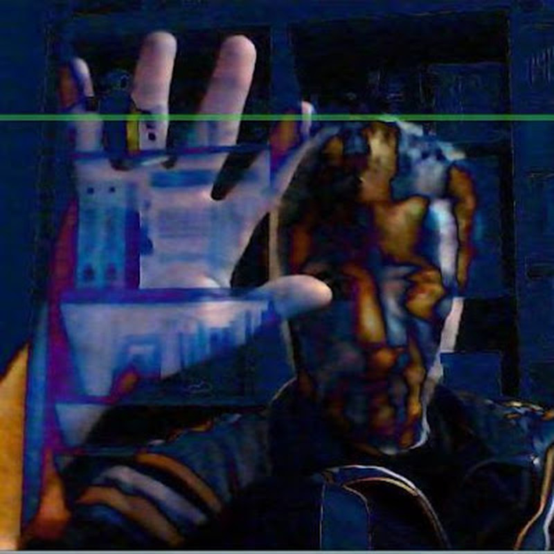

# INTRODUCTION

*Published: 2012-12-08*

**Tags:** experimentation, electronics

---

Hi everyone!

I am Max Farnea, and I have always been passionate about music, computer science, and electronics... and all their mutual contaminations.

The areas I work in are: electronic music composition, live performance, installations, circuit bending, DIY synthesis and audio or MIDI circuits, microcontrollers, creative coding, fractals, video games, and computer graphics.

In the 70s, I witnessed the birth of video games. Then, in the 80s and 90s, home computers and the demoscene arrived.

Synthesizers and vocoders sparked my passion for music, and I studied piano so I could play them.

I started programming the VIC-20 at the age of 13, then moved on to MSX and Amiga. When the Internet began to spread, programming became my job.

I always have my soldering iron in hand, ready to build circuits and void warranties.
