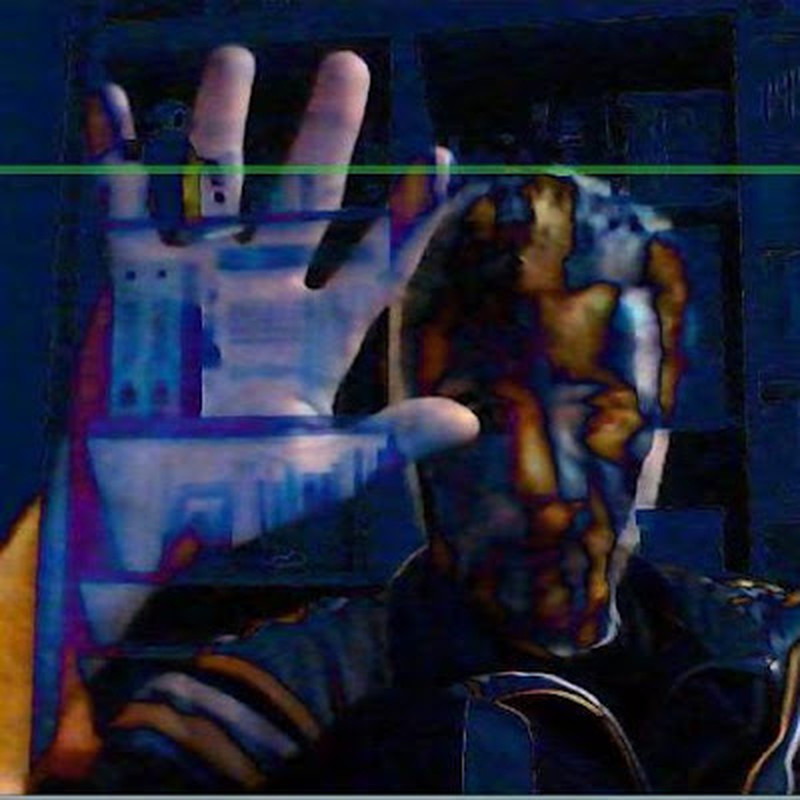

Ciao a tutti!

Sono Max Farnea, e sono da sempre appassionato di musica, informatica ed elettronica... e tutte le loro reciproche contaminazioni.  
  
Gli ambiti in cui mi muovo sono: composizione di musica elettronica, performance live, installazioni, circuit bending, autocostruzione di synth e circuiti audio o MIDI, microcontrollori, coding creativo, frattali, videogiochi e computer grafica.

Negli anni 70 ho visto la nascita dei videogiochi, poi negli anni 80 e 90 sono arrivati gli home computer e la demoscene.

Sintetizzatori e vocoder mi hanno fatto appassionare della musica, ho studiato pianoforte per poterli suonare.

Ho iniziato a programmare il VIC-20 a 13 anni, poi sono passato all'MSX e all'Amiga, e quando ha iniziato a diffondersi Internet programmare è diventato il mio lavoro.

Sono sempre con il saldatore in mano pronto a costruire circuiti e invalidare garanzie.
