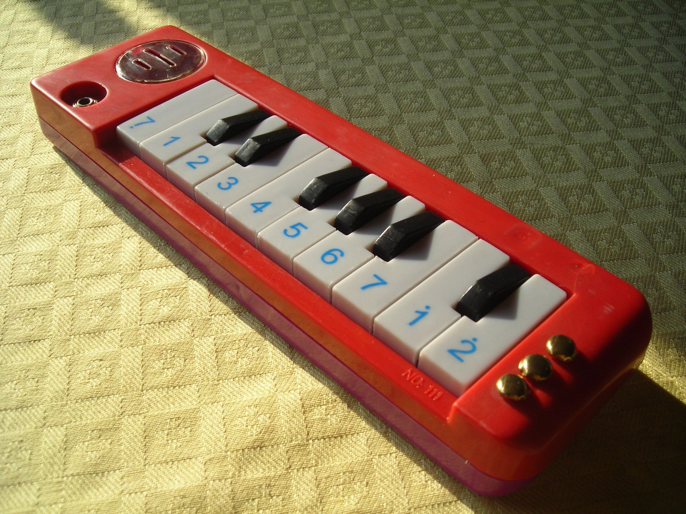
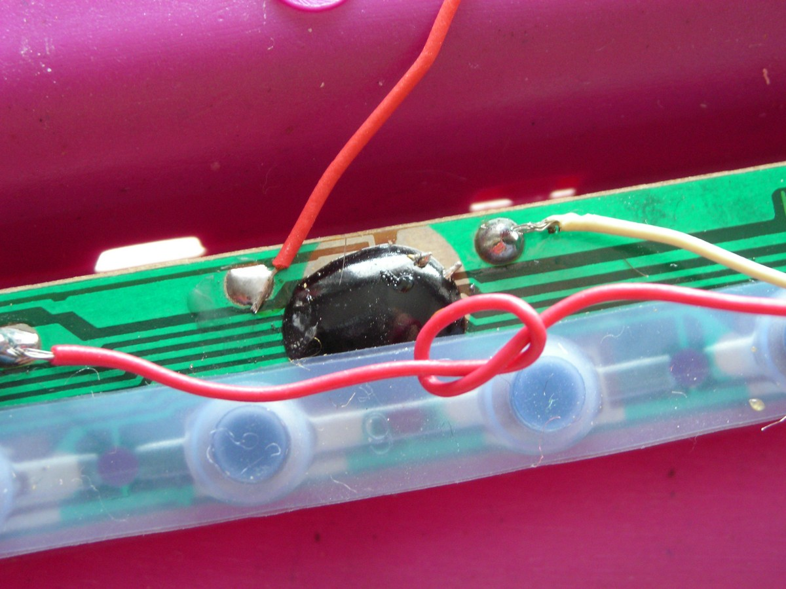
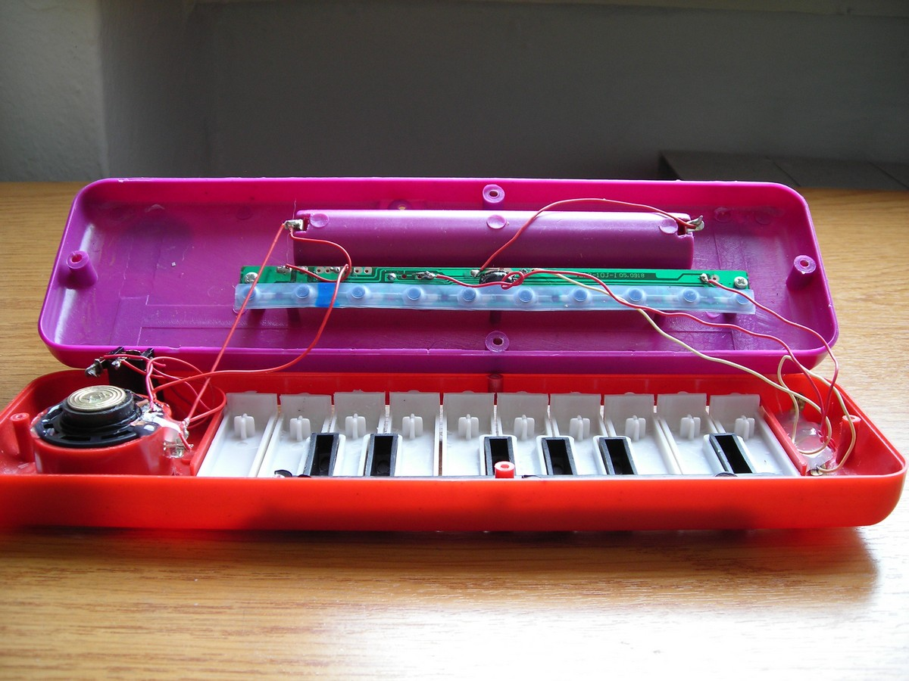
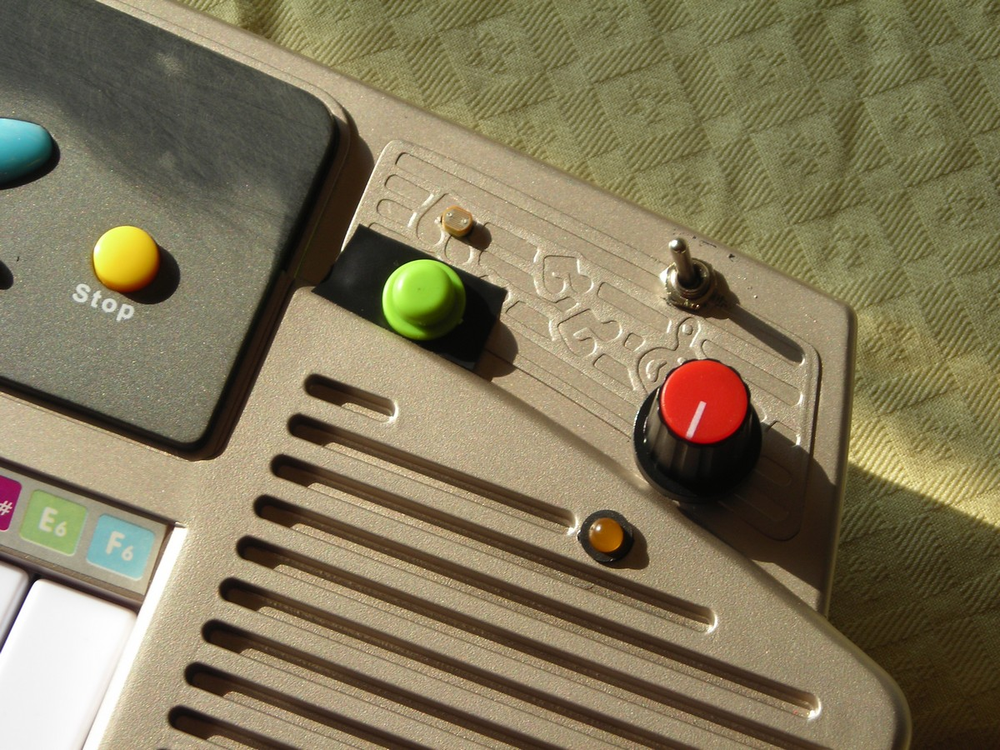
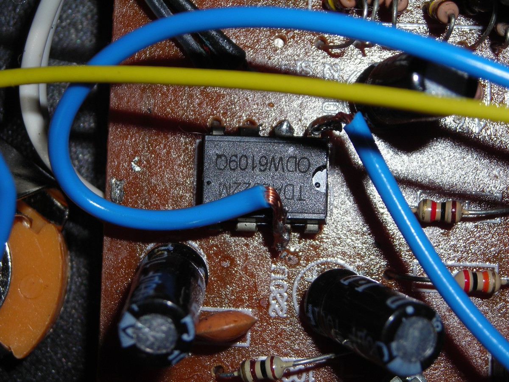
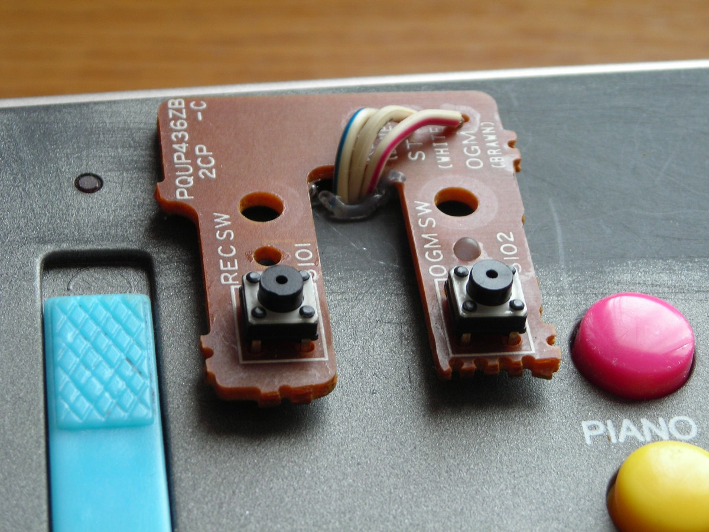

# A GUIDE TO SIMPLE CIRCUIT BENDING

*Published: 2012-12-11*

**Tags:** sounds, circuit, experimentation, toys, glitch, circuitbending, experimental, micromusic, lofi, DIY, noise, guide, electronics

---

The term **circuit bending** refers to the art of creatively modifying, through simple short circuits, low-voltage electronic devices or battery-powered electronic instruments such as toys, keyboards, electronic drums, and guitar effects, with the aim of generating new and unique sounds, creating new musical instruments, and generic sound generators.

My tendency to void warranties by disassembling devices out of pure curiosity aligns perfectly with this technique. Although I generally prefer to plan functional modifications rather than randomly sabotaging electronics, a more informal and creative approach can often lead to pleasant discoveries.

For simple experiments, I recommend using inexpensive toy keyboards, as they allow you to start having fun and get familiar with soldering and electronics while investing very little money. However, it is worth noting that these devices do not offer many circuit bending possibilities, and above all, the plastic keys leave much to be desired if you intend to use them for live performances.

These low-cost products are characterized by the use of hybrid circuits, also known as **"COB"** (Chip On Board). They are completely sealed, and generally, the only accessible parts are an external resistor that controls the pitch of the sound, the audio output (usually connected directly to the speaker), and the keyboard control lines.

The effects we can easily achieve are a variation in the pitch of the sound or audio saturation/distortion. Technically, it is also possible to interface with the keyboard control lines to selectively activate certain sounds. However, this falls into the category of well-planned modifications, far from an intuitive approach based on simple short circuits or soldering.

From a practical point of view, inside the toy, you should look for a black bubble fused onto the printed circuit board—this is the COB. At this point, you can start touching the component terminals with your fingers while playing the instrument to find points that generate interesting effects.

If touching a resistor changes the sound and distorts it, it is most likely the external resistor that controls the pitch.

Now, it is possible to solder wires starting from the two terminals of the resistor and attach the ends of these wires to screws or studs fixed on the external plastic. This way, you will have created **body contacts**, and by touching both with a finger, you can achieve the effect you just discovered. You can also connect the two wires to a **potentiometer** (which has three contacts—just connect the center one and one of the side ones) or to a **photoresistor**.

By touching the contacts, you can vary the pitch of the notes or the playback speed of the samples (if the toy plays samples stored on ROM). Alternatively, if you are using a photoresistor, you can obtain interesting effects by moving a steady or flashing light near it.

Another way to investigate and discover new "hidden" effects in the toy's circuit is to use wires with **alligator clips**. Simply attach one clip to a contact on the circuit (even the positive or negative side of the batteries) and use the other to touch all the other contacts to see what happens.

In many toys, you may also find a circuit with a small amplifier or a mixer, especially in those that also include a microphone. In both cases, it is easy to find a rectangular integrated circuit with 4+4 pins that amplifies or mixes one or two input signals and outputs them. Even in this case, experimenting with short circuits and connections can produce distortion and feedback noise effects.

