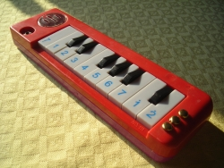
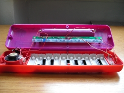
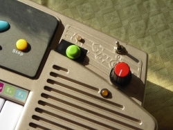
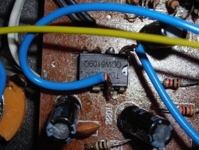
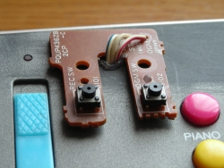

# GUIDA A UN SEMPLICE CIRCUIT BENDING

*Pubblicato: 2012-12-11*

**Tag:** suoni, circuit, sperimentazione, giocattoli, glitch, circuitbending, sperimentale, micromusic, lofi, DIY, noise, guida, elettronica

---

Con il termine **circuit bending** si indica l'arte di modificare in maniera creativa, attraverso semplici cortocircuiti, apparecchi elettronici a basso voltaggio o strumenti elettronici alimentati a pile, come giocattoli, tastiere, batterie elettroniche e effetti per chitarra, allo scopo di generare suoni inediti e curiosi, creare nuovi strumenti musicali e generici generatori di suono.

  

 La mia attitudine ad invalidare garanzie, smontando apparecchi per pura curiosità, è molto in sintonia con questa tecnica. Anche se in genere sono portato a pianificare delle modifiche funzionali e non eseguire un sabotaggio casuale dell'elettronica, spesso un approccio meno formale e più creativo può portare a piacevoli scoperte.  
Per fare dei semplici esperimenti consiglio di utilizzare economiche tastiere giocattolo, in quanto con esse è possibile iniziare a divertirsi e prendere confidenza con saldature ed elettronica investendo veramente pochi Euro. Bisogna tenere conto comunque che esse non offrono tante possibilità di circuit bending e soprattutto le plastiche dei tasti lasciano un po' a desiderare nel caso si intenda usarle per una performance live.  

  

Questi prodotti economici sono caratterizzati dall'utilizzo di circuiti ibridi, detti anche "**COB**" (chip on board). Essi sono completamente sigillati e generalmente le sole parti accessibili sono una resistenza esterna che pilota l'intonazione del suono, l'uscita audio (di solito collegata direttamente all'altoparlante) e le linee di controllo della tastiera.   
  
Gli effetti che riusciamo ad ottenere facilmente sono una variazione dell'intonazione del suono oppure una saturazione o distorsione audio. Tecnicamente è possibile anche interfacciarsi con le linee di controllo della tastiera per attivare selettivamente alcuni suoni, però qui entriamo nel merito di modifiche ben pianificate distanti da un approccio istintivo  basato su semplici cortocircuiti o saldature.  

  

  

 Dal punto di vista pratico, dentro al giocattolo si deve cercare una bolla nera fusa sopra il circuito stampato, questo è il COB. A questo punto si può cominciare a toccare i terminali dei componenti con le dita mentre si suona lo strumento per cercare i punti che generano effetti interessanti.   
Se toccando una resistenza il suono cambia e si distorce molto probabilmente si tratta della resistenza esterna che controlla l'intonazione.   

  

  

  

Ora è possibile saldare dei fili a partire dai due terminali della resistenza e attaccare le estremità di questi fili su delle viti o borchie fissate sulla plastica esterna. Così facendo avremo fatto dei '**body contacts**' e toccandoli entrambi con un dito si ottiene l'effetto appena scoperto. Si possono collegare i due fili anche ad un **potenziometro** (hanno tre contatti, basta collegare quello centrale e uno di quelli laterali), oppure a una **fotoresistenza**.  
  
Quindi toccando i contatti si può variare l'intonazione delle note o la velocità di esecuzione dei campioni (se il giocattolo riproduce campioni memorizzati su ROM), oppure se si sta utilizzando una fotoresistenza si possono ottenere degli effetti interessanti muovendo vicino ad essa una luce fissa o lampeggiante 

  

  

  

Un altro modo di indagare e scoprire nuovi effetti 'nascosti' nel circuito del giocattolo è quello di usare dei cavetti con i **morsetti a coccodrillo**. Basta attaccare un morsetto a un contatto sul circuito (anche il positivo o il negativo delle pile) e con l'altro toccare tutti gli altri contatti e sentire cosa succede.  
  

  

In molti giocattoli è possibile trovare anche un circuito con un piccolo amplificatore oppure un mixer, soprattutto quelli che prevedono anche l'utilizzo di un microfono. In entrambi i casi è facile trovare un integrato rettangolare 4+4 piedini che amplifica o miscela uno o due segnali in ingresso e li riporta in un'uscita.  
Anche in questo caso sperimentando con cortocircuiti e collegamenti si riescono a riprodurre distorsioni e rumori di feedback.  
  

  

