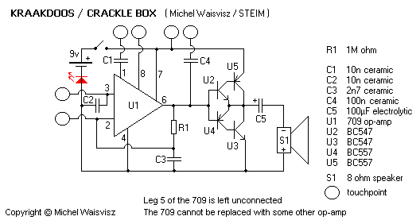
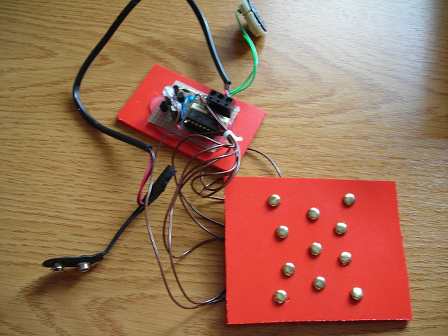

# CRACKLEBOX

*Published: 2013-01-16*

**Tag:** suoni, circuit, sperimentazione, drone, fai da te, do it yourself, circuitbending, glitch, sperimentale, autocostruzione, lofi, DIY, noise, elettronica, avanguardia

---

The term **Cracklebox** (or **Kraakdoos**) refers to a particular type of experimental audio device introduced by **Michel Waisvisz** in the mid-1970s. Michel Waisvisz together with **Reed Ghazala** can be considered in every respect the pioneer of circuit bending, and indeed the Cracklebox is a clear applied example of this technique.  
The peculiarity of this instrument lies in the fact that sound generation depends exclusively on interaction with the human body, which becomes part of the circuit itself. This interaction is not dangerous since this device (like all those in the circuit bending context) is powered by a battery and the intensity of the currents involved is truly negligible. Depending on the local conductivity of human skin, the crackling and squealing noises (crackle) produced vary from person to person (and also over time), making every performance unique.

  

  

  

The heart of the circuit is one of the first operational amplifiers, the **709**, and its behaviour depends precisely on this specific model (now out of production and hard to find). If you use a current op-amp, even one that is 100% compatible, the circuit cannot work as it should: all modern op-amps have built-in compensation systems that make them too stable and insensitive to the current offsets and drifts caused by interaction with the human body, which when amplified produce exactly the noises we want.

  

If you manage to source a 709 op-amp, the other components are very common and building the circuit is fairly simple and quick.  
Otherwise, with considerably more money to spend, you can track down a vintage 1970s Cracklebox or a modern replica still available for sale, thus also acquiring a collector's item.  
  
But you don't need to spend much to get these sounds. Anyone who has experimented with circuit bending will have already discovered many cases where simply touching certain contacts on a printed circuit board can cause pitch variations, glitches or squealing sounds due to feedback loops, stray current ingress or saturations.  
  
You can also design custom circuits with very sensitive simple amplifiers and voltage-controlled oscillators, fitted with metal contacts so that touching them creates interference. This approach is used by various kits available commercially for building circuits expressly dedicated to generating this type of sound.  

  

  

  

  

I managed to source a couple of 709s, with which I built two Cracklebox circuits. One I incorporated into my experimental modular system, The Sound Destruction Unit, while the second I paired with an **Atari Punk Console** to create my **Tamagotchi Mannaro**. These experimental instruments of mine and the Atari Punk Console will be described in detail in upcoming posts — in the meantime here is a preview.  

  

  

Finally, I recommend reading my previous post on circuit bending [[circuit-bending-semplice.en|here]].
