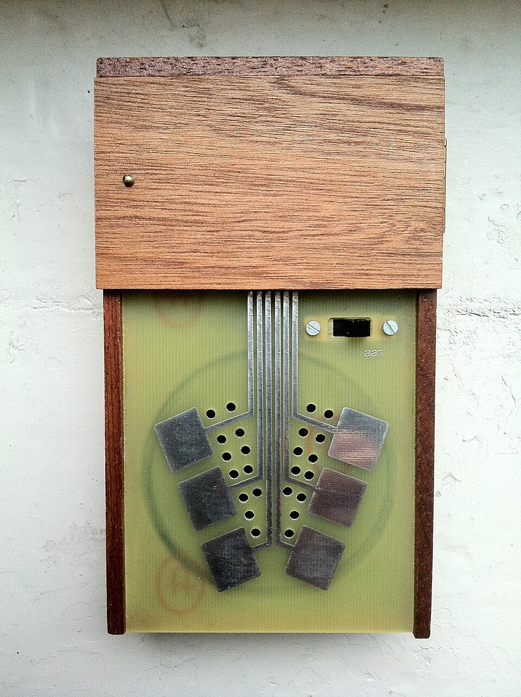
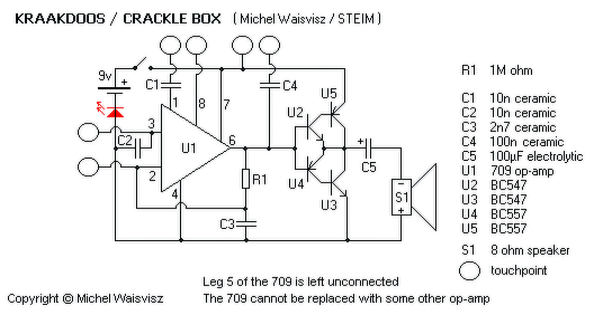

# CRACKLEBOX

*Published: 2013-01-16*

**Tags:** sounds, circuit, experimentation, drone, DIY, do it yourself, circuitbending, glitch, experimental, DIY, lofi, noise, electronics, avant-garde

---

The term **Cracklebox** (or **Kraakdoos**) refers to a particular type of experimental audio device introduced by **Michel Waisvisz** in the mid-1970s. Michel Waisvisz, along with **Reed Ghazala**, can be considered the true pioneer of circuit bending, and indeed, the Cracklebox is a clear practical example of this technique.

The peculiarity of this instrument lies in the fact that sound generation depends exclusively on interaction with the human body, which is part of the circuit itself. This interaction is not dangerous because this device (like all those in the circuit bending context) is battery-powered, and the current intensities involved are truly negligible. Depending on the local conductivity of human skin, the crackling and screeching sounds produced vary from person to person (and also over time), making each performance unique.

The heart of the circuit is one of the first operational amplifiers, the **709**, and its operation depends precisely on this specific model (now out of production and difficult to find). If a modern op-amp is used, even one that is 100% compatible, the circuit still will not work as it should: all modern operational amplifiers have built-in compensation systems that make them too stable and insensitive to the offsets and current drifts caused by interaction with the human body, which, when amplified, produce exactly the noises we want.

If you manage to find a 709 op-amp, the other components are very common, and building the circuit is quite simple and quick. Otherwise, if you have much more money to spend, you can find a used Cracklebox from the 1970s or a modern replica currently still for sale, thus also acquiring a collector's item.

But you don't need to spend a lot to achieve these sounds. Anyone who has experimented with circuit bending will have already discovered many cases where simply touching certain contacts on a printed circuit can cause pitch variations, glitches, or screeching sounds due to feedback loops, parasitic currents entering, or saturation.

You can also design ad hoc circuits for very sensitive simple amplifiers and voltage-controlled oscillators, equipping them with metal contacts so you can interfere with them by touching. This approach is used by various commercial kits designed to create circuits specifically dedicated to generating this type of sound.

I managed to find a couple of 709s, with which I built two Cracklebox circuits. I installed one in my experimental modular system, The Sound Destruction Unit, while the second I paired with an **Atari Punk Console** to create my **Tamagotchi Mannaro**. These experimental instruments of mine and the Atari Punk Console will be described in detail in upcoming posts. For now, I'll leave you with a preview.

