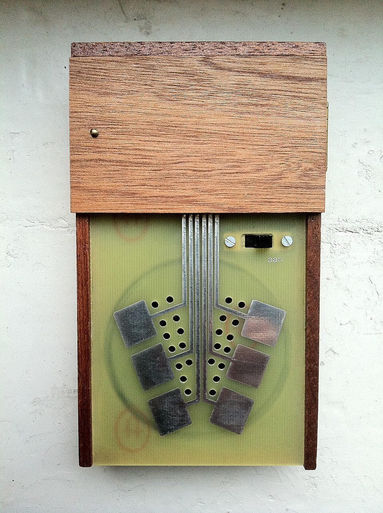
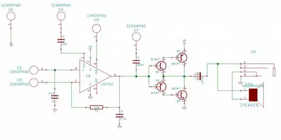

# CRACKLEBOX

*Pubblicato: 2013-01-16*

**Tag:** suoni, circuit, sperimentazione, drone, fai da te, do it yourself, circuitbending, glitch, sperimentale, autocostruzione, lofi, DIY, noise, elettronica, avanguardia

---

Con il termine **Cracklebox** (o **Kraakdoos**) si intende un tipo particolare di dispositivo audio sperimentale introdotto da **Michel Waisvisz** a metà degli anni 70. Michel Waisvisz insieme a **Reed Ghazala** può essere considerato a tutti gli effetti il pioniere del circuit bending e infatti la Cracklebox è un chiaro esempio applicativo di questa tecnica.  
La particolarità di questo strumento consiste nel fatto che la generazione del suono dipende esclusivamente dall'interazione con il corpo umano, il quale è parte del circuito stesso. Questa interazione non è pericolosa in quanto questo dispositivo (come tutti quelli del contesto del circuit bending) è alimentato con una batteria e l'intensità delle correnti in gioco è veramente irrisoria. Dipendendo dalla conduttività locale della pelle umana, i rumori gracchianti e striduli (crackle) prodotti variano da persona a persona (e anche nel tempo), rendendo così le performance sempre uniche tra loro. 

  
Il cuore del circuito è uno dei primi amplificatori operazionali, il **709**, e il suo funzionamento dipende proprio da questo specifico modello (ormai fuori produzione e di difficile reperibilità). Se si usa un operazionale attuale, anche compatibile al 100%, il circuito non può comunque funzionare come dovrebbe: tutti gli operazionali moderni hanno integrati dei sistemi di compensazione che li rendono troppo stabili e insensibili agli offset e derive di corrente causate dall'interazione col corpo umano, che amplificate producono proprio i rumori che vogliamo.

Se si riesce a recuperare un operazionale 709, gli altri componenti sono molto comuni e la realizzazione del circuito è abbastanza semplice e veloce.  
Altrimenti avendo molti più soldi da spendere si può recuperare una Cracklebox usata degli anni 70 o una replica moderna attualmente ancora in vendita, aggiudicandosi così anche un oggetto da collezione.  
  
Ma non serve spendere molto per avere queste sonorità. Chi ha sperimentato con il circuit bending avrà già scoperto molti casi in cui il semplice tocco di alcuni contatti di un circuito stampato può causare variazioni di pitch, glitch o suoni striduli dovuti a loop di feedback, ingresso di correnti parassite o saturazioni.  
  
Si possono anche progettare ad hoc circuiti di semplici amplificatori molto sensibili e oscillatori controllati in tensione e dotarli di contatti metallici in modo da interferire con essi toccandoli. Questo approccio è utilizzato da svariati kit che si trovano in commercio per realizzare circuiti espressamente dedicati alla generazione di questo tipo di sonorità.  

Io sono riuscito a reperire un paio di 709, con i quali ho realizzato due circuiti Cracklebox. Uno l'ho inserito nel mio sistema modulare sperimentale, The Sound Destruction Unit, mentre il secondo l'ho abbinato ad una **Atari Punk Console** creando il mio **Tamagotchi Mannaro**. Questi miei strumenti sperimentali e l'Atari Punk Console saranno descritti dettagliamente nei prossimi post, intanto vi lascio qualche anteprima.  

