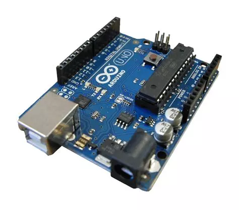
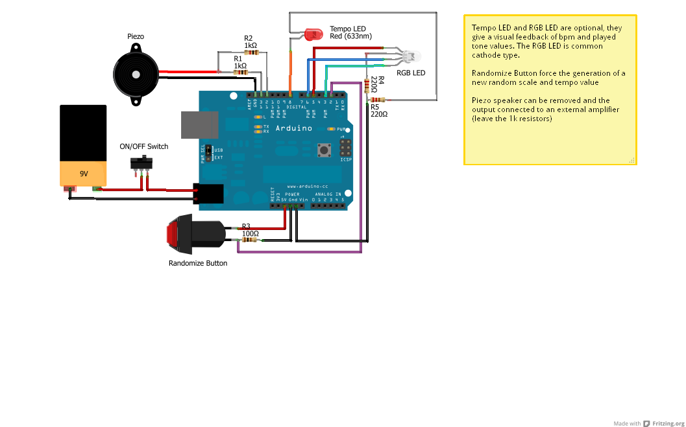

# AN AUTOGENERATIVE CARILLON WITH ARDUINO

*Published: 2013-01-25*

**Tags:** sounds, project, DIY, do it yourself, download, experimental, DIY, arduino, algorithms, programming, electronics, microcontrollers

---

After years spent programming Motorola 68HC11 or Microchip PIC microcontrollers for robotics or musical projects, discovering Arduino was like a breath of fresh air.

This incredible Italian product has now become a well-established global paradigm for hobbyist and digital circuit prototyping. The number of projects that use it, the resources available online, the clones, and the various expansions (shields) available are proof of this.

After a few tests to get familiar with the environment, I decided to create a project of my own. Starting from the idea of creating a musical toy for my daughter, I built a solid foundation for experimenting with algorithms for autogenerative music, and thus, this autogenerative carillon was born.

### Specifications

The carillon consists of two voices (bass and melody) randomly generated based on a pentatonic scale, which is also chosen randomly.

The base sequence is 4 bars of 4/4.

The bass moves on the quarter note, following a 2-bar pattern repeated twice.

The melody is composed of eighth notes and possibly rests, following a complete 4-bar pattern. The melody moves at least one octave above the bass.

The melody starts deactivated and, at the end of each complete 4-bar cycle, can enter as a random event: each cycle has a 75% chance of activating until it happens.

After each complete 4-bar cycle, the algorithm decides whether to regenerate the notes of the bass, melody, or both.

Pressing an external button generates an interrupt that sets a new scale and a new tempo. The current note sequences are not regenerated by the button: they will continue until the natural regeneration at the end of the cycle.

The stored pentatonic scales are 24—12 major and 12 minor.

The execution tempo can take one of the preset values: 60, 90, 120, 180.

### Technical Details

At software startup, the random generator is initialized with the value present at Arduino's analog input 0. If nothing is connected, the seed is set randomly based on noise; otherwise, you can set a specific seed value using a potentiometer.

A software switch, to be enabled at compile time, adds an additional degree of variability, allowing the temporary alteration of a melody note by a semitone during execution. The scale used for the alteration is not randomly chosen each time but is fixed: for major scales, the degree corresponding to the immediately following pentatonic is used, while for minor scales, the immediately preceding pentatonic is used.

The randomness of variations in the melody structure is not uniform; it is possible to set a weight to make it more or less variable. For example, while the choice of scale and tempo is equally probable, the probability that the melody will be activated after the first bass cycle is 75%, while the probability that a note will be altered by a semitone is 10% (if the alteration is enabled). Finally, the probability that after a cycle, the bass or melody will be recreated is 50%. All these weights are constants that can be set at compile time.

Sound generation occurs via two outputs connected to a piezoelectric transducer. The Tone Library by Rogue Robotics Open Source Code was used:

[http://code.google.com/p/rogue-code/wiki/ToneLibraryDocumentation](http://code.google.com/p/rogue-code/wiki/ToneLibraryDocumentation)

One digital output varies based on the execution tempo, allowing LEDs to flash in time with the music.

The color of the RGB LED does not depend on the tempo but continuously maps the notes being played: for every eighth note, the hue is calculated by combining the bass note and the melody note being played, with the bass note dominating the color wheel and the melody modulating the shade.

#### Hardware and Wiring

The entire project is powered by a 9V battery and a switch, with no need for any additional circuits beyond Arduino. The two Tone outputs do not use two speakers: they are summed via two resistors and connected to a single piezo—a small analog mixer, the simplest possible to build. The RGB LED is common cathode, driven with three 220Ω resistors (a software constant, `invert`, allows the use of common anode models as well). The randomize button works via interrupt with a 10kΩ resistor, and there is a dedicated LED that flashes every quarter note, in time with the music.

### Future Experimental Developments

Replacing internal sound generation with a MIDI output to use external musical hardware.

Digital outputs to control solenoids or servo motors in time with the music.

Implementation of a microtonal approach.

**Download the project here:** [autocarillion_20171119.zip](https://drive.google.com/open?id=1zxxcqw6c4hkAz1sPAUXPeEl9tLGii8Qt)

**IMPORTANT:** The Tone Library has not been updated for Arduino IDEs after 0023. To resolve compilation issues in newer development environments, simply edit the Tone.cpp file and replace the `wiring.h` import with `Arduino.h`, as also discussed in the Arduino forum [here](http://forum.arduino.cc/index.php?topic=87398.0). Alternatively, you can download my already modified version [here](https://drive.google.com/open?id=0B5R3uOmkGTIrNW4ycFdsT3VzV28)

### UPDATE 2017-11-20

After some time, I returned to this project to update it. Essentially, I included a purely MIDI version that sends notes via a standard MIDI port connected to Arduino's TX pin. In the new archive, you will also find the schematic for connecting a simple MIDI OUT port.

Within the source code of the MIDI implementation, you will find the `midiChannel` variable to configure the MIDI channel (default 1), and the `bass_octave` and `voice_octave` variables to set the octave for bass and melody (default 2 and 4).

With this release, the standard version has also undergone a small update in the definition of scales.

**You can download the new archive here:** [autocarillion_20171119.zip](https://drive.google.com/open?id=1zxxcqw6c4hkAz1sPAUXPeEl9tLGii8Qt)
