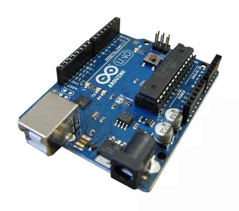

# UN CARILLON AUTOGENERATIVO CON ARDUINO

*Pubblicato: 2013-01-25*

**Tag:** suoni, progetto, fai da te, do it yourself, download, sperimentale, autocostruzione, arduino, DIY, algoritmi, programmazione, elettronica, microcontrollori

---

Dopo anni passati a programmare microcontrollori Motorola 68HC11 o Microchip PIC per progetti di robotica o musicali, la scoperta di Arduino è stata come una ventata di ossigeno fresco.  

Questo incredibile prodotto italiano è ormai un paradigma consolidato a livello mondiale per quanto riguarda l'hobbistica e la prototipizzazione di circuiti digitali. Il numero di progetti che lo utilizza, le risorse disponibili in rete, i cloni e le varie espansioni disponibili (shield) ne sono la prova.

Dopo qualche prova per prendere confidenza con l'ambiente ho deciso di realizzare un progetto tutto mio, e partendo dall'idea di realizzare un giocattolo musicale per mia figlia, ho realizzato una buona base per sperimentare con algoritmi per musica autogenerativa ed è nato questo carillon autogenerativo.  

### Specifiche 

Il carillon consiste di due voci (basso e melodia) generate casualmente sulla base di una scala pentatonica, anch'essa scelta casualmente.  
  
La sequenza di base sono 4 battute da 4/4.  
  
Il basso si muove sul quarto di nota, su un pattern di 2 battute ripetuto due volte.  
  
La melodia è composta con ottavi di nota ed eventualmente pause, su un pattern completo di 4 battute. La melodia si muove ad almeno un'ottava sopra al basso.  
  
La melodia parte disattivata e, al termine di ogni giro completo di 4 battute, può entrare come evento casuale: a ogni giro ha una probabilità del 75% di attivarsi, finché non succede. 
  
Dopo ogni giro completo di 4 battute, l'algoritmo decide se rigenerare le note del basso o della melodia o di entrambi.  
  
La pressione di un pulsante esterno genera un interrupt che imposta una nuova scala e un nuovo tempo. Le sequenze di note in corso non vengono rigenerate dal pulsante: continueranno fino alla naturale rigenerazione a fine giro. 
  
Le scale pentatoniche memorizzate sono 24, 12 maggiori e 12 minori.  
  
Il tempo di esecuzione può assumere uno dei valori preimpostati: 60, 90, 120, 180.  

### Dettagli Tecnici  

All'avvio del software, il generatore casuale viene inizializzato con il valore presente nell'ingresso analogico 0 di Arduino. Se non vi è collegato nulla, il seme viene impostato casualmente in base al rumore, altrimenti è possibile impostare tramite un potenziometro uno specifico valore per il seme.  
  
Uno switch software, da abilitare in fase di compilazione, aggiunge un ulteriore grado di variabilità, permettendo in fase di esecuzione l'alterazione momentanea di una nota della melodia di un semitono. La scala usata per l'alterazione non è scelta casualmente di volta in volta, ma fissa: per le scale maggiori viene usato il grado corrispondente della pentatonica immediatamente successiva, per le minori quello della pentatonica immediatamente precedente. 
  
La casualità delle variazioni nella struttura della melodia non è uniforme, ma è possibile impostare un peso per renderla più o meno variabile. Ad esempio mentre la scelta della scala e del tempo è equiprobabile, la probalitità che la melodia venga attivata dopo il primo giro di basso è del 75%, mentre la probabilità che una nota venga alterata di un semitono è del 10% (se l'alterazione è abilitata). Infine la probabilità che dopo un giro il basso o la melodia venga ricreata è del 50%. Tutti questi pesi sono costanti che possono essere impostate al momento della compilazione.  
  
La generazione del suono avviene tramite due uscite a cui è collegato un trasduttore piezo. E' stata utilizzata la Tone Library by Rogue Robotics Open Source Code:  
  
[http://code.google.com/p/rogue-code/wiki/ToneLibraryDocumentation](http://code.google.com/p/rogue-code/wiki/ToneLibraryDocumentation)  
  
Un'uscita digitale varia in base al tempo di esecuzione, potendo far lampeggiare dei LED a tempo di musica.  
  
Il colore del LED RGB non dipende dal tempo, ma mappa in continuo le note suonate: a ogni ottavo, la tinta (hue) viene calcolata combinando la nota del basso e quella della melodia in esecuzione, con la nota del basso a dominare la ruota dei colori e la melodia a modulare la sfumatura.

#### Hardware e wiring

L'intero progetto si alimenta con una batteria da 9V e un interruttore, senza bisogno di alcun circuito aggiuntivo oltre ad Arduino. Le due uscite Tone non usano due altoparlanti: vengono sommate tramite due resistenze e collegate a un unico piezo — un piccolo mixer analogico, il più povero che si possa costruire. Il LED RGB è a catodo comune, pilotato con tre resistenze da 220Ω (una costante software, `invert`, permette di usare anche modelli ad anodo comune). Il pulsante di randomize lavora su interrupt con una resistenza da 10kΩ, e c'è un LED dedicato che lampeggia a ogni quarto, a tempo di musica.  

### Futuri Sviluppi Sperimentali  

Sostituzione della generazione interna dei suoni con un'uscita MIDI in modo da utilizzare hardware musicale esterno.  

Uscite digitali per pilotare solenoidi o servomotori a tempo di musica.  

Implementazione di un approccio microtonale.

**Scaricate il progetto qui**: [autocarillion_20171119.zip](https://drive.google.com/open?id=1zxxcqw6c4hkAz1sPAUXPeEl9tLGii8Qt)

**IMPORTANTE**: la Tone Library non è stata aggiornata per gli IDE Arduino successivi allo 0023. Per risolvere i problemi di compilazione negli ambienti di sviluppo più recenti basta editare il file Tone.cpp e sostituire l'import wiring.h con Arduino.h, come discusso anche nel forum Arduino [qui](http://forum.arduino.cc/index.php?topic=87398.0). Oppure potete scaricare la mia versione già modificata [qui](https://drive.google.com/open?id=0B5R3uOmkGTIrNW4ycFdsT3VzV28)

### UPDATE 2017-11-20

Dopo un po' di tempo sono tornato su questo progetto per aggiornarlo, in pratica ho incluso una versione puramente MIDI che invia le note tramite una porta MIDI standard collegata al pin TX di Arduino. Nel nuovo archivio trovate anche lo schema per collegare una semplice porta MIDI OUT.

All'interno del sorgente dell'implementazione MIDI trovate la variabile midiChannel per configurare il canale MIDI (default 1), e le varibili bass_octave e voice_octave per impostare l'ottava su cui far lavorare basso e melodia (default 2 e 4).

Con questo rilascio anche la versione standard ha subito un piccolo aggiornamento nella definizione delle scale.

**Potete scaricare il nuovo archivio qui:** [autocarillion_20171119.zip](https://drive.google.com/open?id=1zxxcqw6c4hkAz1sPAUXPeEl9tLGii8Qt)