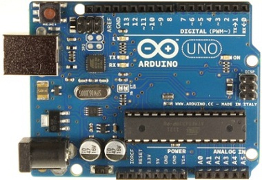
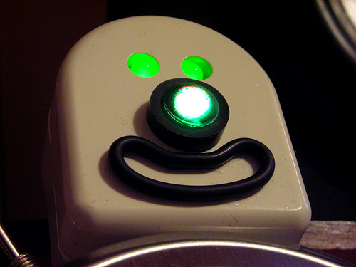
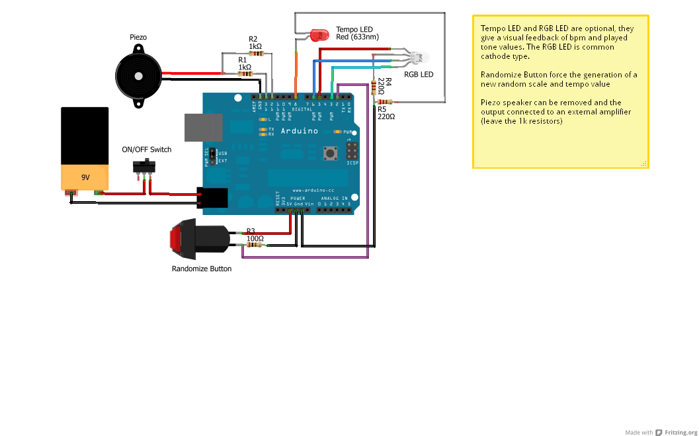

# UN CARILLON AUTOGENERATIVO CON ARDUINO

*Pubblicato: 2013-01-25*

**Tag:** suoni, progetto, fai da te, do it yourself, download, sperimentale, autocostruzione, arduino, DIY, algoritmi, programmazione, elettronica, microcontrollori

---

Dopo anni passati a programmare microcontrollori Motorola 68HC11 o Microchip PIC per progetti di robotica o musicali, la scoperta di Arduino è stata come una ventata di ossigeno fresco.   

  

Questo incredibile prodotto italiano è ormai un paradigma consolidato a livello mondiale per quanto riguarda l'hobbistica e la prototipizzazione di circuiti digitali. Il numero di progetti che lo utilizzano, le risorse disponibili in rete, i cloni e le varie espansioni disponibili (shield) ne sono la prova.

  

Dopo qualche prova per prendere confidenza con l'ambiente ho deciso di realizzare un progetto tutto mio, e partendo dall'idea di realizzare un giocattolo musicale per mia figlia, ho realizzato una buona base per sperimentare con algoritmi per musica autogenerativa ed è nato questo carillon autogenerativo.  

  

**Specifiche**  

  
Il carillon consiste di due voci (basso e melodia) generate casualmente sulla base di una scala pentatonica, anch'essa scelta casualmente.  
  
La sequenza di base sono 4 battute da 4/4.   
  
Il basso si muove sul quarto di nota, su un pattern di 2 battute ripetuto due volte.  
  
La melodia è composta con ottavi di nota ed eventualmente pause, su un pattern completo di 4 battute. La melodia si muove ad almeno un'ottava sopra al basso.  
  
Il primo giro di basso avviene senza la melodia, che entra in una delle seguenti battute, in base a una scelta casuale.  
  
Dopo ogni giro completo di 4 battute, l'algoritmo decide se rigenerare le note del basso o della melodia o di entrambi.  
  
La pressione di un pulsante esterno genera un interrupt che resetta l'algoritmo, impostando una nuova scala e un nuovo tempo.  
  
Le scale pentatoniche memorizzate sono 24, 12 maggiori e 12 minori.  
  
Il tempo di esecuzione può assumere uno dei valori preimpostati: 60, 90, 120, 180.  

  

**Dettagli Tecnici**  

  

All'avvio del software, il generatore casuale viene inizializzato con il valore presente nell'ingresso analogico 0 di Arduino. Se non vi è collegato nulla, il seme viene impostato casualmente in base al rumore, altrimenti è possibile impostare tramite un potenziometro uno specifico valore per il seme.  
  
Uno switch software, da abilitare in fase di compilazione, aggiunge un ulteriore grado di variabilità, permettendo in fase di esecuzione l'alterazione momentanea di una nota della melodia di un semitono (viene eseguito il grado corrispondente della scala pentatonica immediatamente precedente o successiva a quella corrente).  
  
La casualità delle variazioni nella struttura della melodia non è uniforme, ma è possibile impostare un peso per renderla più o meno variabile. Ad esempio mentre la scelta della scala e del tempo è equiprobabile, la probalitità che la melodia venga attivata dopo il primo giro di basso è del 75%, mentre la probabilità che una nota venga alterata di un semitono è del 10% (se l'alterazione è abilitata). Infine la probabilità che dopo un giro il basso o la melodia venga ricreata è del 50%. Tutti questi pesi sono costanti che possono essere impostate al momento della compilazione.  
  
La generazione del suono avviene tramite due uscite PWM a ciu è collegato un trasduttore piezo. E' stata utilizzata la Tone Library by Rogue Robotics Open Source Code:  
  
[http://code.google.com/p/rogue-code/wiki/ToneLibraryDocumentation](http://code.google.com/p/rogue-code/wiki/ToneLibraryDocumentation)  
  
Un'uscita digitale varia in base al tempo di esecuzione, potendo far lampeggiare dei LED a tempo di musica.  
  
Tre uscite invece sono configurate per pilotare un LED RGB il cui colore continua a variare in base al tempo e la frequenza delle note suonate. 

  

**Futuri Sviluppi Sperimentali**  
  
Sostituzione della generazione interna dei suoni con un'uscita MIDI in modo da utilizzare hardware musicale esterno.  
  
Uscite digitali per pilotare solenoidi o servomotori a tempo di musica.  
  
Implementazione di un approccio microtonale.

  

  

** ****Scaricate il progetto qui**: [autocarillion_20171119.zip](https://drive.google.com/open?id=1zxxcqw6c4hkAz1sPAUXPeEl9tLGii8Qt)

  

** ****IMPORTANTE**: la Tone Library non è stata aggiornata per gli IDE Arduino successivi allo 0023. Per risolvere i problemi di compilazione negli ambienti di sviluppo più recenti basta editare il file Tone.cpp e sostituire l'import wiring.h con Arduino.h, come discusso anche nel forum Arduino [qui](http://forum.arduino.cc/index.php?topic=87398.0). Oppure potete scaricare la mia versione già modificata [qui](https://drive.google.com/open?id=0B5R3uOmkGTIrNW4ycFdsT3VzV28)
