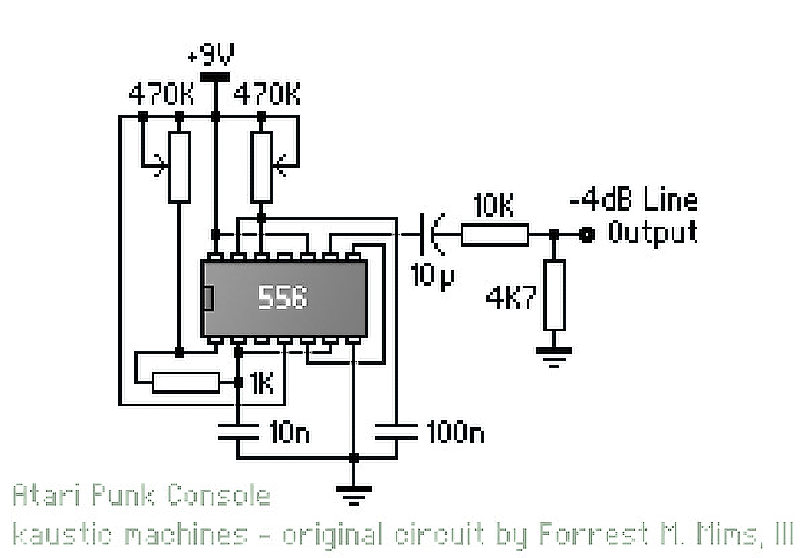
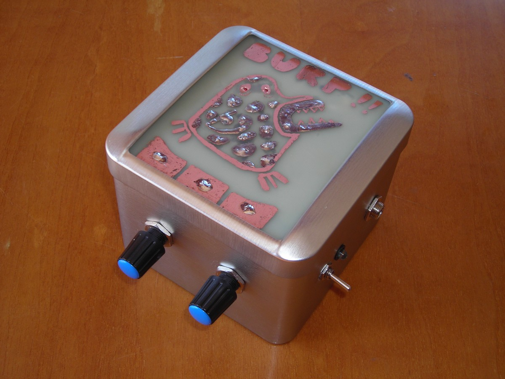
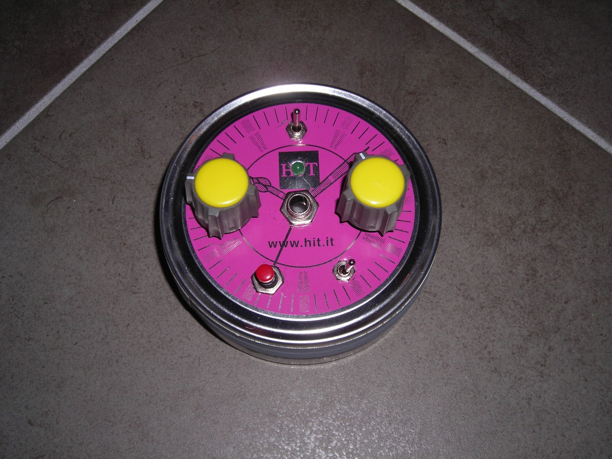
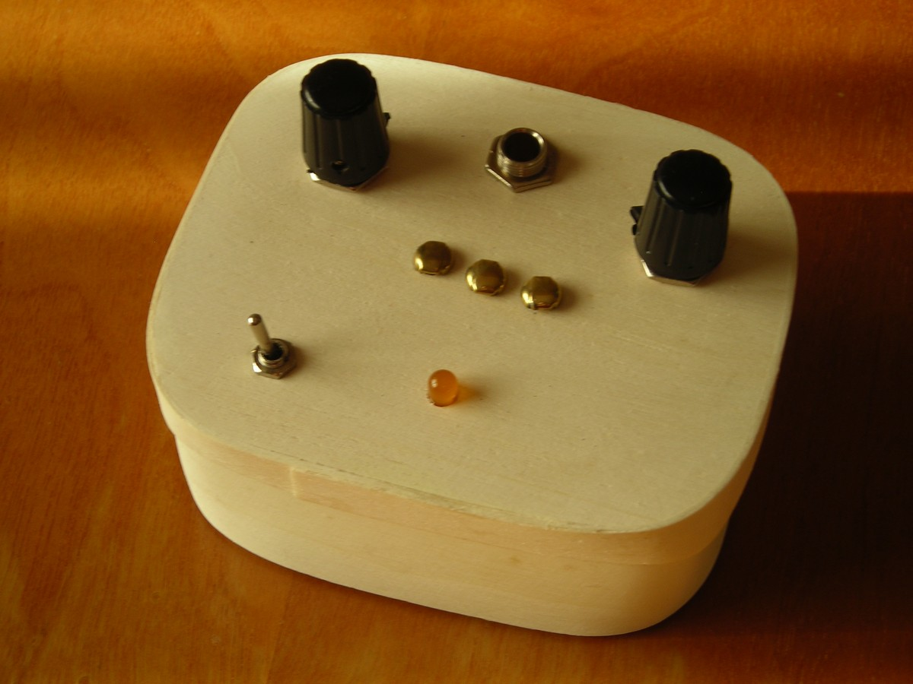

# ATARI PUNK CONSOLE

*Published: 2013-03-09*

**Tags:** sounds, circuit, experimentation, drone, DIY, synthesizer, do it yourself, glitch, experimental, DIY, lofi, noise, electronics

---

Here is another post dedicated to a basic device for those who want to experiment with electronics in the audio context: the **Atari Punk Console** (also known as APC).

The history of the APC is unique because it was not born in the context of experimental music; it first appeared as an educational circuit, the "Stepped Tone Generator," described in the book "Engineer's Mini-Notebook - 555 Circuits" by **Forrest M. Mims III**.

This generator is a simple square wave oscillator whose frequency and pulse width can be controlled.

The circuit was later modified by **Kaustic Machines**, adding an audio output at -4dB, and after being renamed with the name by which it is now known, it became one of the most widely used experimental audio circuits.

Like the previously described Cracklebox, the APC is based on a very simple circuit that anyone with minimal skills required for a handful of soldering can build. However, unlike the Cracklebox, the Atari Punk Console does not use hard-to-find components—it uses a NE556 (or two NE555s), which is an inexpensive and widely available component, making this circuit practically a must for anyone who loves building their own lo-fi sounds and effects. Here are some examples of Atari Punk Consoles I have built:

A variant can be introduced by using photoresistors instead of one or both potentiometers that control the frequency and pulse width. I have used APCs modified in this way in a couple of experimental projects, which I will describe in my upcoming posts. For now, here is a preview.

