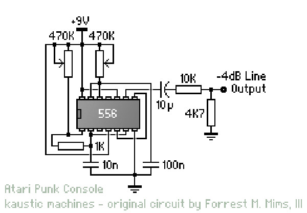
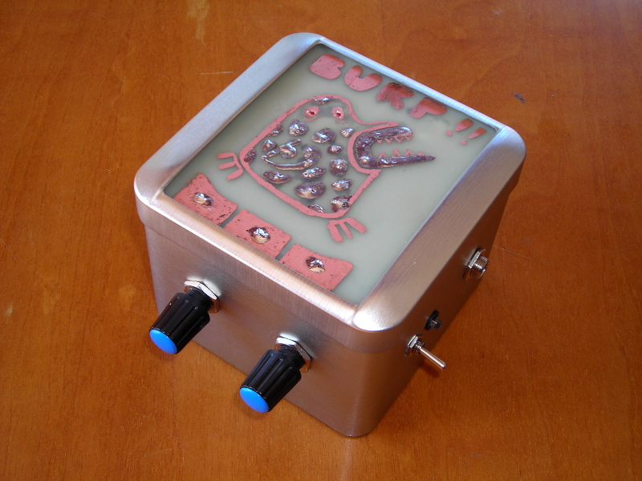
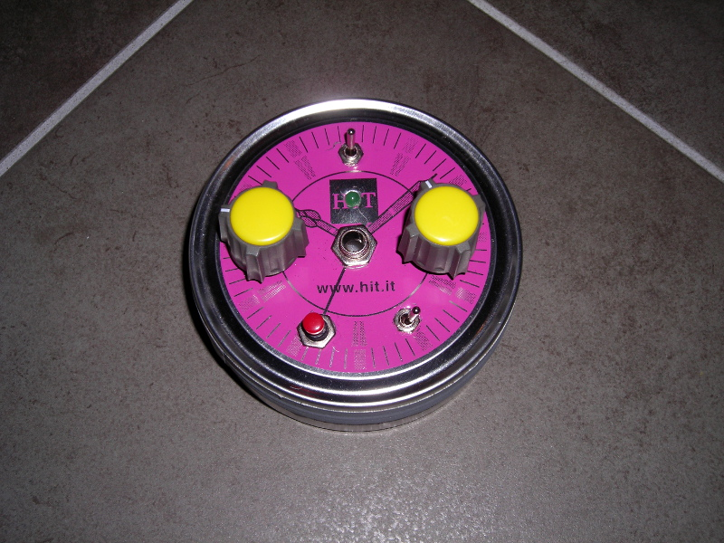
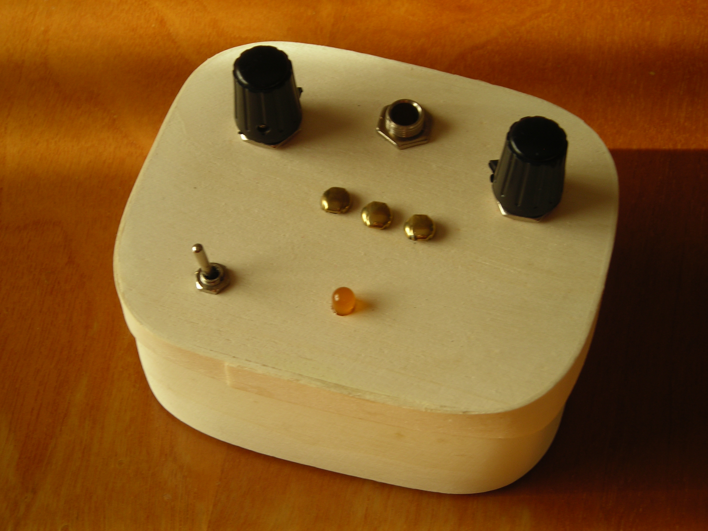

# ATARI PUNK CONSOLE

*Pubblicato: 2013-03-09*

**Tag:** suoni, circuit, sperimentazione, drone, fai da te, sintetizzatore, do it yourself, glitch, sperimentale, autocostruzione, lofi, DIY, noise, elettronica

---

Ecco un altro post dedicato a un dispositivo basilare per chi vuole sperimentare con l'elettronica nel contesto audio: l'**Atari Punk Console** (detta anche APC).  

 La storia dell'APC è particolare perché non è nata in un ambito di musica sperimentale; essa ha fatto la sua prima comparsa come circuito didattico, lo "Stepped Tone Generator", descritto nel libro "Engineer's Mini-Notebook - 555 Circuits" di **Forrest M. Mims III**.   
  
Questo generatore è un semplice oscillatore a onda quadra del quale è possibile controllare la frequenza e la lunghezza dell'impulso.  
   
Il circuito è stato in seguito modificato da **Kaustic Machines** aggiungendo un'uscita audio a -4db, e dopo essere stato ribattezzato col nome con cui è ora conosciuto, è diventato uno dei circuiti audio sperimentali più diffusi.  

Come la Cracklebox precedentemente descritta, l'APC si basa su un circuito molto semplice e realizzabile da chiunque abbia quel minimo di manualità richiesta per fare una manciata di saldature. L'Atari Punk Console però non utilizza componenti di difficile reperibità, essa utilizza un NE556 (o due NE555) che è un componente economico e reperibile ovunque e che fa di questo circuito praticamente una tappa forzata per chi ama costruirsi i propri suoni ed effetti lo-fi. Ecco qualche esempio di Atari Punk Console che ho costruito:   

  

Si può introdurre una variante utilizzando fotoresistenze al posto di uno o entrambi i potenziometri che controllano la frequenza e la larghezza dell'impulso. Ho utilizzato APC così modificate in un paio di progetti sperimentali, che descriverò nei miei prossimi post, dei quali vi lascio però qui un'anteprima.  

