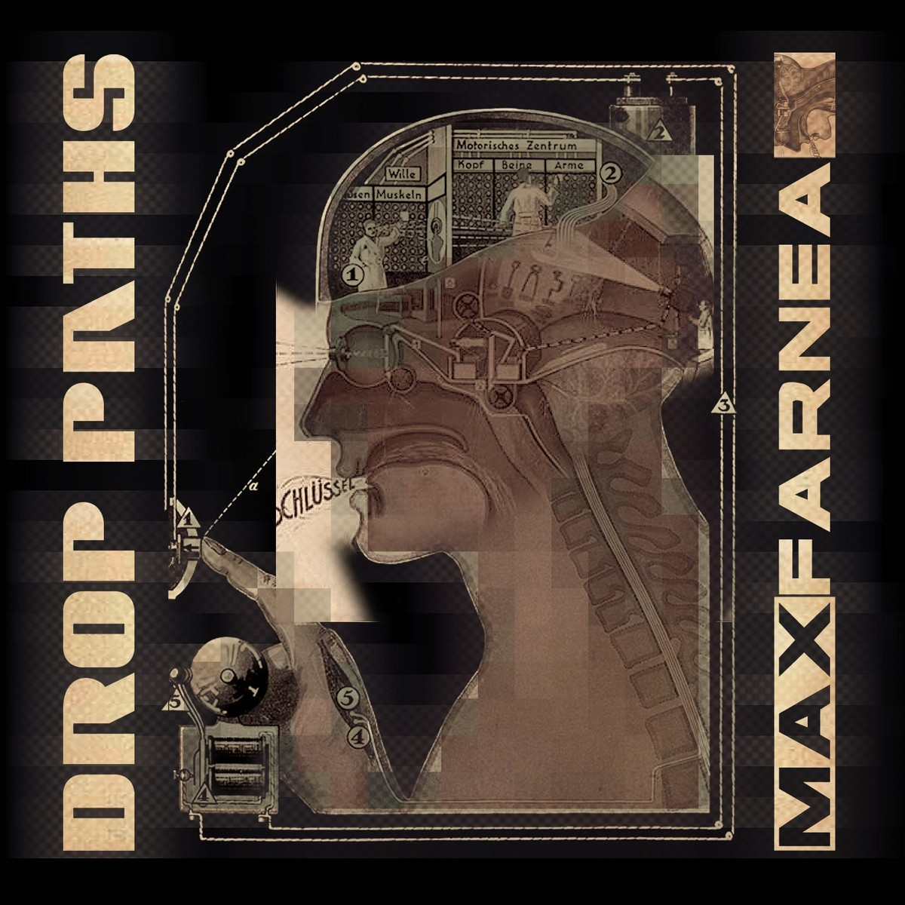

# DROP PATHS: A MOMENT OF REFLECTION

*Published: 2014-07-31*

**Tags:** download, album, music, electronics

---

It has been a long time since I last created a musical project or performed live. This same blog, my website, or my social media accounts have been quite lacking in updates over the past two years or so.

A pause imposed by personal and family reasons, new priorities—the usual reasons, in short.

However, this silence has allowed me to take stock of everything I have produced in previous years, also drawing from the (unfortunately rare) feedback I have received on everything I have made freely available on the Internet.

Doubt has emerged (including the very philosophy of sharing everything for free), but also an awareness of the type of musical message I want to identify with: music must shape itself with those who listen to it.

It should not explicitly communicate concepts or feelings but should evoke and amplify those already present within each of us, without force.

When I compose, I love creating varied soundscapes and atmospheres—sometimes minimal, experimental, or lo-fi; other times, I seek melody and harmonization. In some cases, the sound scene can be confined to a small closed box; in others, it can open up and even become rarefied and continuously expanding.

If the listener enters into a symbiosis with one of my musical scenarios and can visualize it and make it their own, then I have achieved my goal.

**Drop Paths**, the album I released three years ago before this break, was born precisely from this need of mine to summarize everything I had produced, to weave together the paths I had taken and try to fit them into a homogeneous and coherent framework. A milestone from which to restart.

Finally, the gears are starting to move again. While waiting for the next updates, I invite you all to listen to and download Drop Paths by clicking on the image below.

