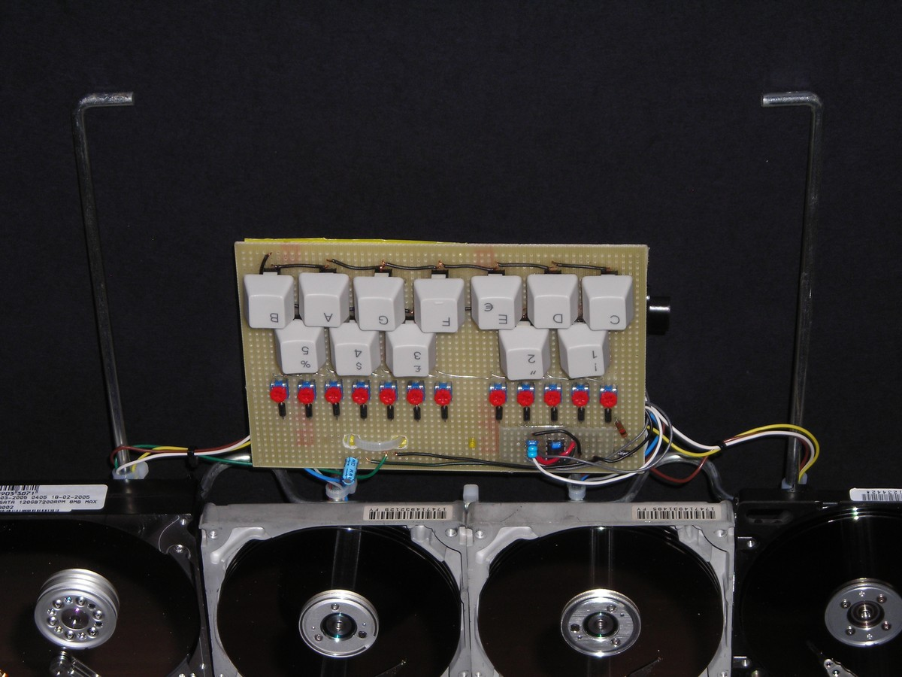
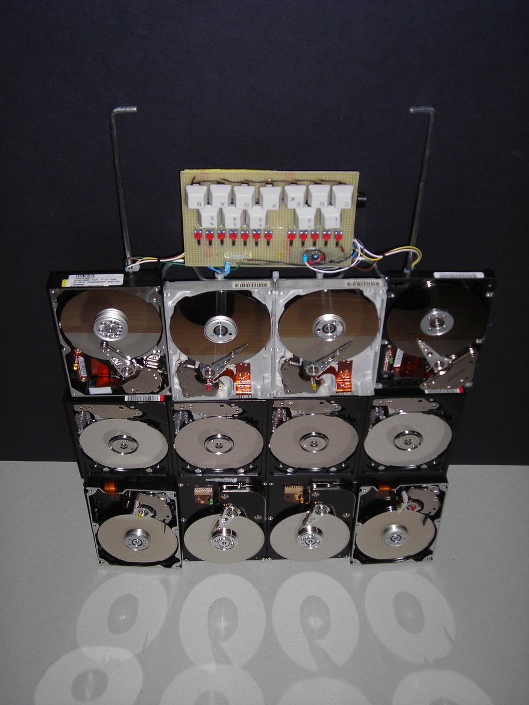

# HARDISCOFONO

*Published: 2015-05-16*

**Tags:** sounds, experimentation, project, drone, DIY, synthesizer, do it yourself, experimental, circuitbending, performance, glitch, DIY, lofi, noise, electroacoustic, electronics

---

Having some faulty hard drives at my disposal, I wanted to take advantage of the fact that if you drive the head solenoid with an amplified audio signal, its vibrations through the metal disks make the audio signal audible.

This is a very crude electromechanical effect compared to the operation of a real speaker, but it is still appreciable if you want to generate sound textures with a very metallic timbre.

However, I did not want to use this effect just to produce sounds. There are already many examples online of hard drives and floppy drives driven by PWM signals that can even play MIDI files.

I wanted to create something that was as similar as possible to an instrument, simulating its physicality above all.

This is how the "hardiscofono" (or "ardiscofono") was born: a set of 12 hard drives mounted on a grid that can be held by a handle or placed on the ground, with a keyboard of twelve keys (one octave).

Pressing one of the keys makes one of the drives play a signal generated by an oscillator. Each key is associated with a single drive and generates a specific frequency that can be tuned independently with a trimmer paired with each key.

This instrument is still a work in progress, although I have already used it, for example, in the final part of Hardiscophone, which you can listen to below.

