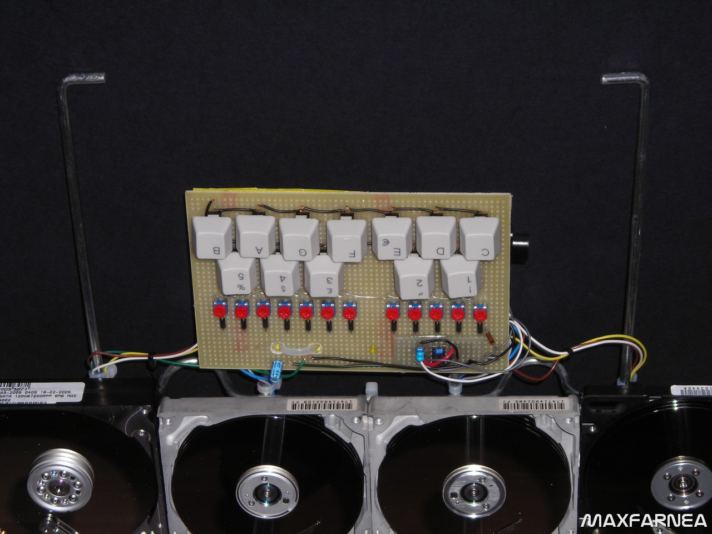
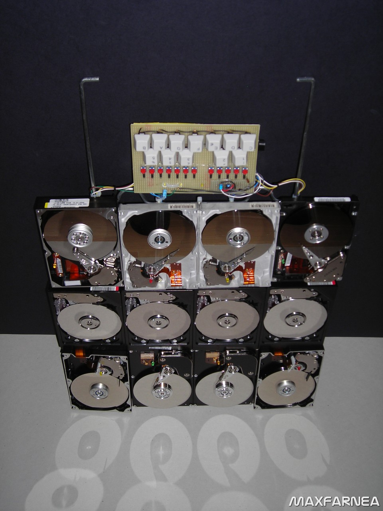

# HARDISCOFONO

*Pubblicato: 2015-05-16*

**Tag:** suoni, sperimentazione, progetto, drone, fai da te, sintetizzatore, do it yourself, sperimentale, circuitbending, performance, glitch, autocostruzione, lofi, DIY, noise, elettroacustico, elettronica

---

Avendo a disposizione alcuni hard disk guasti, ho voluto sfruttare il fatto che se si pilota con un segnale audio amplificato il solenoide del braccio delle testine, le vibrazioni di quest'ultimo tramite i dischi metallici, rendono udibile il segnale audio.

  

E' un effetto elettromeccanico molto grezzo se confrontato con il funzionamento di un vero altoparlante, però è comunque apprezzabile se si vogliono generare texture sonore con un timbro molto metallico.

  

Non volevo però sfruttare questo effetto solo per produrre suoni; ci sono già tanti esempi in rete di hard disk e floppy drive che pilotati da segnali PWM riescono a riprodurre anche file MIDI.

  

Volevo realizzare qualcosa che fosse il più possibile simile ad uno strumento, che ne simulasse soprattutto la fisicità.

  

  

  

Così è nato l'hardiscofono (o ardiscofono): un insieme di 12 harddisk montati su una griglia che si può reggere tramite una maniglia o appoggiare a terra, con una tastiera di dodici tasti (un'ottava).  

  

  

  

Premendo uno dei tasti si fa riprodurre a uno dei dischi un segnale generato da un oscillatore. Ogni tasto è associato ad un singolo disco e genera una specifica frequenza che può essere accordata in modo indipendente con un trimmer abbinato ad ogni tasto.  

  

  

Questo strumento è ancora un work in progress, anche se l'ho già utilizzato ad esempio nella parte finale di Hardiscophone, che potete ascoltare qua sotto.  

  

