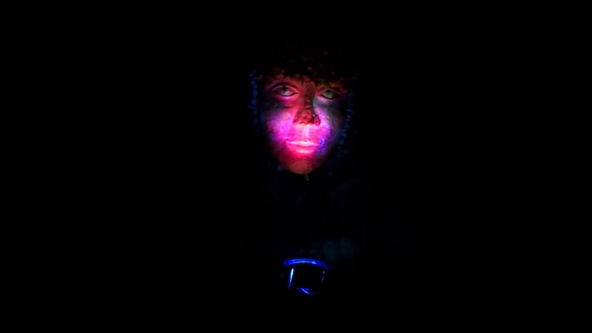

# PATH FESTIVAL 2014 INSTALLATION

*Published: 2015-05-17*

**Tags:** installation, sounds, experimentation, project, drone, DIY, do it yourself, performance, experimental, DIY, arduino, concert, algorithms, noise, music, electronics, live

---

For the 2014 edition of [Path Festival](http://www.pathfestival.it/), I prepared an interactive installation consisting of a mannequin wearing my optoelectronic mask based on the Atari Punk Console (which I have already discussed [here](../20130309/atari-punk-console.md)), to which I paired a self-generative LED sequencer made with Arduino.

The light sequencer, placed in front of the mask by one of the mannequin's arms, infinitely produces light patterns whose colors, structure, and speed vary over time according to a stochastic algorithm.

The installation is interactive as it allows direct interference with sound generation by stimulating the optical sensors with an external light source operated by the visitor, such as a portable lamp, strobe LEDs, or the backlit screen of a smartphone.

