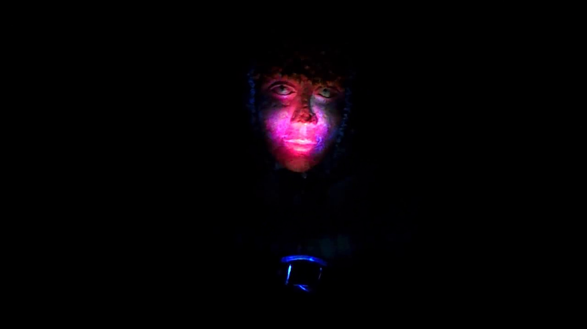

# INSTALLATION PATH FESTIVAL 2014

*Published: 2015-05-17*

**Tag:** installazione, suoni, sperimentazione, progetto, drone, fai da te, do it yourself, performance, sperimentale, autocostruzione, arduino, DIY, concerto, algoritmi, noise, musica, elettronica, live

---

For the 2014 edition of [Path Festival](http://www.pathfestival.it/) I prepared an interactive installation consisting of a mannequin wearing my optoelectronic mask based on Atari Punk Console (which I have already talked about [[atari-punk-console.en|here]]), to which I paired a self-generative LED sequencer built with Arduino.

  

  

The light sequencer, placed in front of the mask by one of the mannequin's arms, endlessly produces light patterns whose colors, structure and speed vary over time according to a stochastic algorithm.  

  

The installation is interactive in that it is possible to directly interfere with the sound generation by stimulating the optical sensors with an external light source operated by the visitor, such as a portable lamp, stroboscopic LEDs or the backlit screen of a smartphone.

  

