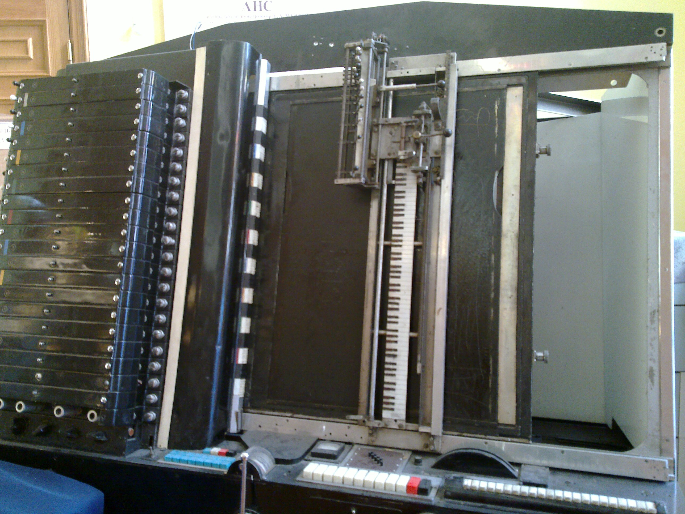

# ANS SYNTHESIZER

*Published: 2015-05-18*

**Tags:** synthesizer, experimental, experimentation, electronics, avant-garde, drone

---

The ANS synthesizer is an experimental machine developed by Russian engineer **Evgeny Murzin** between 1937 and 1957; its name is composed of the initials of the Russian composer **Alexander Nikolayevich Scriabin**, to whom it is dedicated.

The machine is based on a cinematographic technique that makes it possible to visualize (and therefore print on a medium) an audio spectrum. Using this technique, 144 tracks were printed on 5 glass discs so that they could generate a total of 720 light beams modulated at different frequencies, spaced 16.67 cents apart, and capable of covering a range of 10 octaves.

By Charles Hutchins (Flickr: ANS Synthesiser) [CC BY 2.0], via Wikimedia Commons

The light beams are passed through a glass plate that can be made opaque using a special plasticine on which you can write or draw. A mobile arm with mounted optical sensors scans the plate and allows the unattenuated light beams to be detected by the sensors, which are then electronically summed and amplified.

If the plate is made to allow all 720 light beams to pass simultaneously, the instrument reproduces the entire sound spectrum, so it is a fully polyphonic system.

The sounds of the ANS synthesizer have been used by several Russian composers in the second half of the last century, but the most significant contribution was made by Edward Artemiev, who wrote several soundtracks for Russian director **Andrei Tarkovsky** with this machine, particularly the effects and ambient textures of **Solaris**.

More recently, sessions with the ANS synthesizer have been conducted by **Coil** and **Alva Noto**.

There are several emulators of this instrument or its operating principle, but the most realistic in terms of audio synthesis and image interpolation is certainly [Virtual ANS](http://www.warmplace.ru/soft/ans/) by **Alexander Zolotov**. Below is a small test I created with this software:

