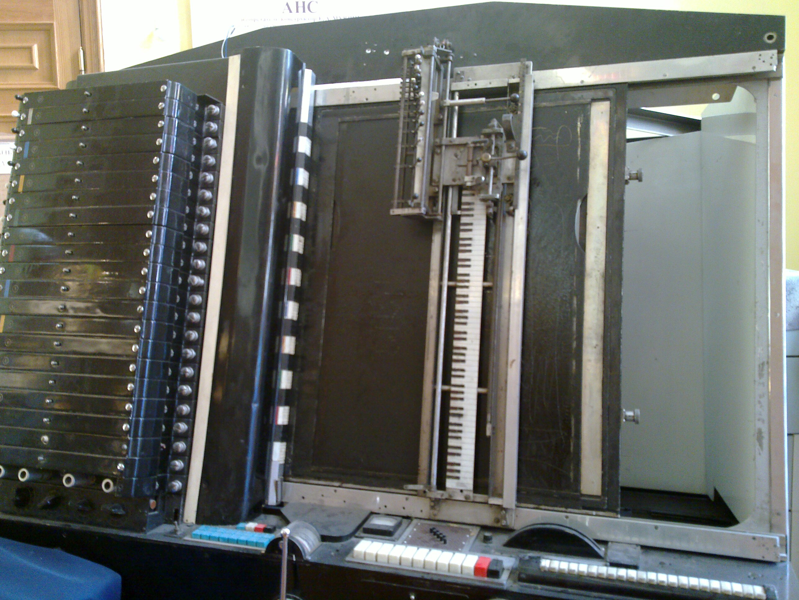

# SINTETIZZATORE ANS

*Pubblicato: 2015-05-18*

**Tag:** sintetizzatore, sperimentale, sperimentazione, elettronica, avanguardia, drone

---

Il sintetizzatore ANS è una macchina sperimentale sviluppata dall'ingegnere russo **Evgeny Murzin** tra il 1937 e il 1957; il suo nome è composto dalle iniziali del compositore russo **Alexander Nikolayevich Scriabin** a cui essa è dedicata.   
La macchina si basa su una tecnica cinematrografica che rende possibile visualizzare (e quindi stampare su un supporto) uno spettro audio. Con questa tecnica sono state stampate 144 tracce su 5 dischi di vetro in modo che potessero generare un totale di 720 fasci di luce modulata a frequenze diverse, distanziate 16,67 cents tra di loro, e in grado di coprire un'estensione di 10 ottave.
  

By Charles Hutchins (Flickr: ANS Synthesiser) [CC BY 2.0],via Wikimedia Commons  
  

I fasci di luce vengono fatti passare attraverso una lastra di vetro che può essere resa opaca tramite una speciale plastilina sulla quale si può scrivere o disegnare. Un braccio mobile su cui sono montati dei sensori ottici, scansiona la lastra e permette che i fasci di luce non attenuati dalla lastra vengano rilevati dai sensori, per essere poi sommati elettronicamente e amplificati.  
  
Se si fa in modo che la lastra lasci passare contemporaneamente tutti i 720 fasci di luce, lo strumento riproduce l'intero spettro sonoro, quindi è un sistema totalmente polifonico.  
  
Le sonorità del sintetizzatore ANS sono state utilizzate da diversi compositori russi nella seconda metà del secolo scorso, ma il contributo più significativo lo ha dato Edward Artemiev che ha scritto con questa macchina diverse colonne sonore per il regista russo **Andrei Tarkovsky**, in particolare gli effetti e le texture ambient di **Solaris**.  
  
Più recentemente invece, sessioni con il sintetizzatore ANS sono state realizzate dai **Coil** e da **Alva Noto**.  
  

Esistono diversi emulatori di questo strumento o del suo principio di funzionamento, ma il più realistico in termini di sintesi audio e interpolazione delle immagini è sicuramente [Virtual ANS](http://www.warmplace.ru/soft/ans/) di **Alexander Zolotov**. Ecco di seguito una piccola prova da me realizzata con questo software:

  

