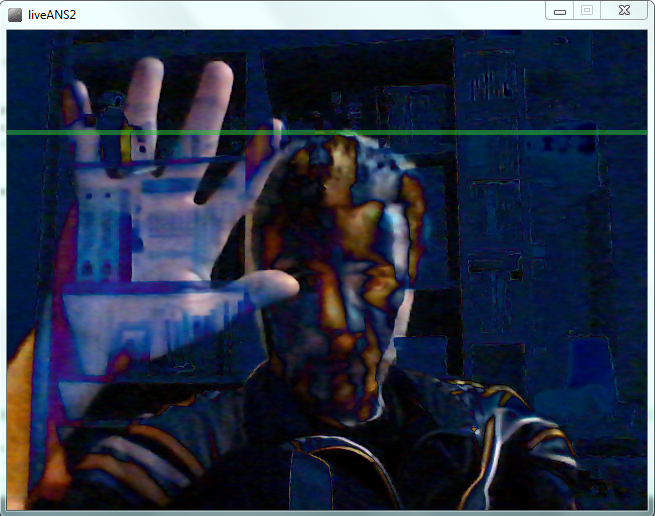

# INSTALLATION DRUMMOND GATE 2015

*Published: 2015-05-23*

**Tag:** installazione, suoni, sperimentazione, progetto, sintetizzatore, multimediale, performance, sperimentale, algoritmi, noise, processing, musica, programmazione, live

---

This installation is based on software I developed that allows images to be captured in real time via a webcam and, after processing them to emphasize the moving parts, transforms them into an audio spectrum through a vertical scan, following a process that imitates the operation of an ANS synthesizer.  
  
By sitting in front of Live ANS it is possible to see one's processed and scanned image on a screen, while listening to the result of the audio spectrum generation through headphones. It is possible to interact in real time with the process by moving one's head or hands in front of the webcam.  
  
This project does not intend to be another ANS synthesizer simulator; it is characterized and differs from the operation of the original machine in the following respects, which also open the way to new experiments:  
  

- the scan occurs vertically in an infinite loop.

- the scanned image is not static but, being a video, is in continuous evolution.

- reading a row of the image during the scan occurs in a digital context, i.e., instead of detecting via an analog sensor the presence of a light beam in a given area, the RGB values of the pixels are read directly. This allows working not only with brightness but also with colors, or processing the images and extracting from them, for example, only the moving parts.

- the sound is not produced from the frequencies with which the light beams are modulated — frequencies generated upstream by the light itself — but is synthesized by a virtual-analog library from hundreds of oscillators whose frequencies depend on the RGB values of the various pixels. Here too the programmatic approach also allows experimenting with different waveforms for the individual frequency components, as well as potentially implementing more sophisticated modulations or audio filters and effects.

  

