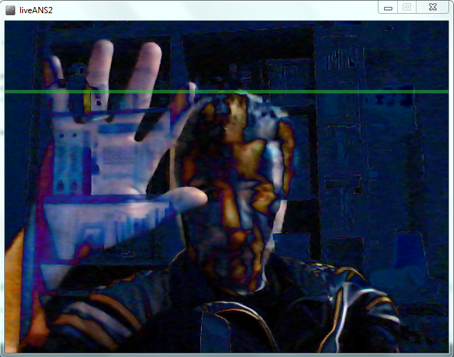

# DRUMMOND GATE 2015 INSTALLATION

*Published: 2015-05-23*

**Tags:** installation, sounds, experimentation, project, synthesizer, multimedia, performance, experimental, algorithms, noise, processing, music, programming, live

---

This installation is based on software I developed that allows real-time image acquisition via a webcam and, after processing them to emphasize the moving parts, transforms them into an audio spectrum through a vertical scan, following a process that mimics the operation of an ANS synthesizer.

By sitting in front of Live ANS, you can see your processed and scanned image on a screen, while listening to the result of the audio spectrum generation through headphones. It is possible to interact in real time with the process by moving your head or hands in front of the webcam.

This project does not aim to be another ANS synthesizer simulator; it characterizes and differs from the operation of the original machine in the following aspects, which also open the door to new experiments:

- The scan occurs vertically in an infinite loop.

- The scanned image is not static; since it is a video, it is continuously evolving.

- Reading a line of the image during scanning occurs in a digital context. Instead of detecting the presence of a light beam in a given area using an analog sensor, the RGB values of the pixels are read directly. This allows working not only with brightness but also with colors, or processing the images to extract, for example, only the moving parts.

- The sound is not produced from the frequencies with which the light beams are modulated (which are generated upstream by the light itself), but is synthesized by a virtual-analog library with 120 oscillators whose frequencies are fixed, arranged on a chromatic grid of ten octaves, while the amplitudes depend on the brightness of the scanned pixels, with a quadratic curve that emphasizes the peaks of movement. The programmatic approach also allows experimenting with different waveforms for the individual frequency components, as well as potentially implementing more sophisticated modulations, filters, and audio effects.

- The project exists in two versions, which are also two different philosophies of the same instrument. The second, in addition to the oscillator version just described, abandons the chromatic grid: the spectrum read from the image, with its hundreds of dense and continuous bands, is rendered directly into audio via an inverse Fourier transform, without oscillators. This is the approach most faithful to the spirit of the original ANS, whose 720 frequencies spaced 16.67 cents apart certainly do not resemble the musical scale.

