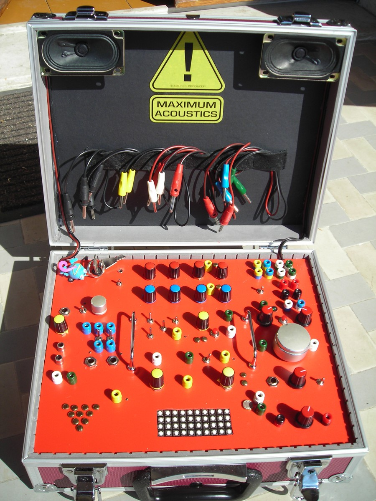
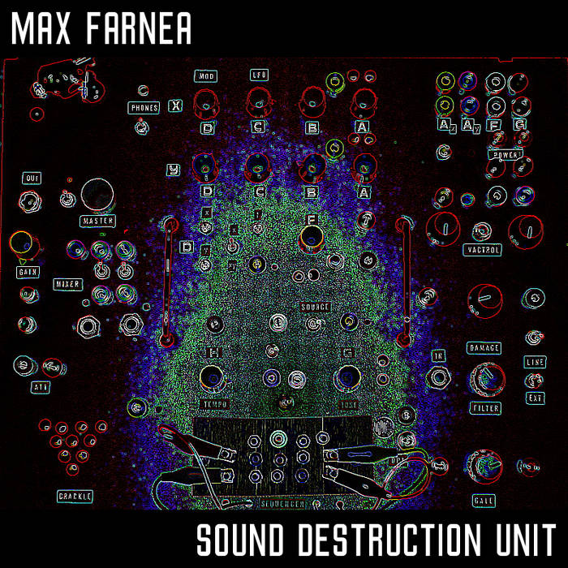

# SOUND DESTRUCTION UNIT

*Published: 2015-05-27*

**Tags:** sounds, project, drone, DIY, synthesizer, do it yourself, glitch, experimental, circuitbending, DIY, noise, electronics

---

The **Sound Destruction Unit** is a system composed of various self-built audio circuits (pattern generator, oscillators, cracklebox, filters, body contacts), assembled in an amplified case and interconnected by unipolar jacks like analog modular synths. Each main control is exposed through an interface to be driven by external TTL signals and digital potentiometers managed via MIDI, thanks to a self-built interface.

The creation took about a year, although over the subsequent years it underwent revisions and various additions, including a Vactrol-controlled line and a gate.

Although I tried, as much as possible, to make the circuits reliable by avoiding feedback or unwanted instability, I preferred to maintain an experimental attitude in the construction, as in circuit bending. Given the nature and heterogeneity of the circuits, many configurations lead to particular results, often unpredictable due to internal loops and saturation.

It is a very personal device that I will never be able to replicate, difficult to tame for studio use but perfect for a live performance.

By recording live improvisations performed exclusively with this instrument, to which I only added an external reverb, I created a completely experimental free EP distributed by **ManyFeetUnder HomeMadeLabel**, which you can listen to and download by clicking on the image below.

