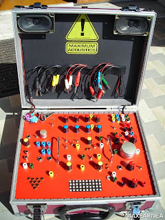
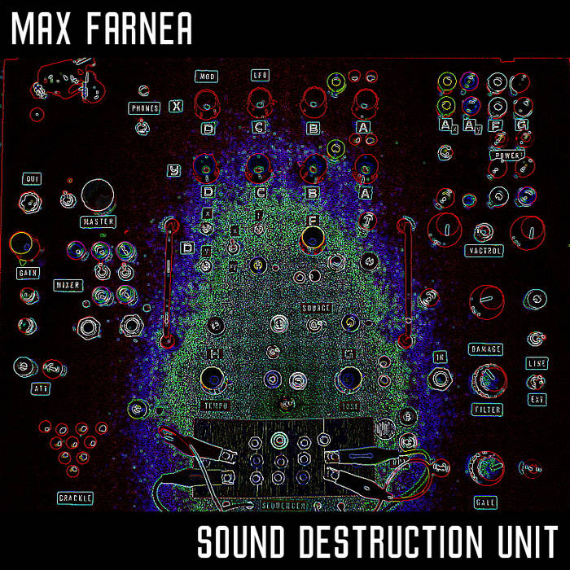

# SOUND DESTRUCTION UNIT

*Published: 2015-05-27*

**Tag:** suoni, progetto, drone, fai da te, sintetizzatore, do it yourself, glitch, sperimentale, circuitbending, DIY, noise, elettronica

---

**The Sound Destruction Unit** is a system composed of various self-built audio circuits (pattern generator, oscillators, cracklebox, filters, body contacts), assembled in an amplified suitcase and interconnected by unipolar jacks like analog modular synths. Each main control is exposed through an interface to be driven by external TTL signals and digital potentiometers managed via MIDI thanks to an also self-built interface.

  

The build took about a year, although over the following years it underwent revisions and several additions including a Vactrol-controlled line and a gate.  
  
Although I tried as much as possible to make the circuits reliable, avoiding unwanted feedback or instabilities, I preferred to maintain an experimental attitude in the build, as in circuit bending. Given the nature and heterogeneity of the circuits, many configurations lead to particular results, often unpredictable due to internal loops and saturations.  
  
It is a very personal device, one I will never be able to replicate, difficult to tame for studio use, but perfect for a live performance.
  

  

By recording live improvisations performed exclusively with this instrument, to which I added only an external reverb, I produced a completely experimental free EP distributed by **ManyFeetUnder HomeMadeLabel** that you can listen to and download by clicking the image below.  

  

