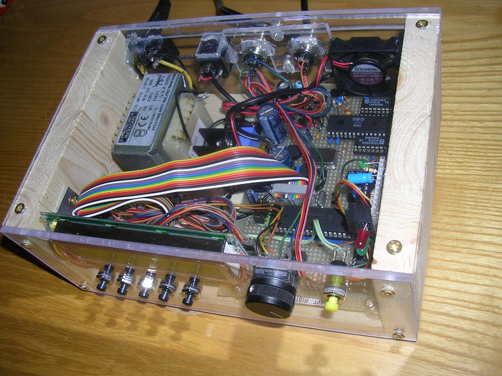

# THE MIDIBOX PLATFORM

*Published: 2016-06-16*

**Tags:** synthesizer, do it yourself, DIY, MIDI, programming, electronics, microcontrollers, DIY

---

The **MIDIbox** platform is an open source hardware and software project by **Thorsten Klose** for self-building **MIDI** systems (processors, controllers, sequencers, or expander modules) that are non-commercial yet offer professional-level features and performance.

It is a mature and long-lasting architecture that originated in 1998 and has been continuously developed and updated, with a well-established community.

At a high level, the MIDIbox system consists of a core hardware module to which other core modules or specific input/output modules can be connected (digital, analog, CV, MIDI), as well as display modules (LEDs or displays) or sound generation modules (MOS **SID** or Yamaha **OPL3**). The hardware is controlled by a real-time MIDI operating system (called **MIOS**) that provides basic communication functionality (MIDI, USB, etc.), user interface and display management, and patch editing and saving. On top of MIOS, specific firmware is developed for the type of instrument you want to build.

>>> ### The Core
>>>
>>> The heart of the vast majority of MIDIbox projects is the **MBHP Core** module, whose main component is the **PIC18F452** microcontroller from Microchip: a 40 MHz controller (with an external 10 MHz crystal) capable of handling the platform's analog and digital modules with latencies below one millisecond. The PIC is a "system on chip": CPU, 32k of flash for the program, 1536 bytes of RAM, 256 bytes of EEPROM, an A/D converter, and a UART for MIDI, all in a single chip.
>>>
>>> The choice of this processor is also a practical one: the PIC is available in **DIP** package, can be hand-soldered without risking damage to SMD pins, is inexpensive, widely available, and nearly indestructible. First, electronics become accessible, then software: the idea is that even a beginner with a soldering iron can see a project through to completion.
>>>
>>> The rest of the module is essential: the power supply accepts 7 to 10 volts, alternating or direct current with indifferent polarity (there is a rectifier on board), the MIDI interface, and connectors for the platform's modules: AIN for analog inputs, DIN for buttons, DOUT for LEDs, IIC for BankSticks (the memories that store configurations). Each function is a separate module that connects to the core: you build exactly what you need, nothing more.
>>>
>>> One detail that captures the spirit of the platform: the firmware is loaded **via MIDI**, as a SysEx dump. No programmers or special cables are needed: MIDI itself is the development interface.

Speaking of a core module to which specific modules can be connected naturally brings **Arduino** and its shields to mind. One might wonder why some users choose this platform over the Italian-made board, and what this architecture offers that is different. Well, MIDIbox is nearly 20 years old, so it was created and spread when Arduino did not yet exist. But it is not just a matter of timing: the entire project is specifically designed for building MIDI systems, meaning both the hardware and software are optimized for musical applications. The performance is impressive (latency can even drop below one millisecond), and the hardware capabilities allow for features and user interfaces comparable to commercial products.

Since this is a **DIY** platform where you have to build the hardware, customize the firmware, compile it, and transfer it to the microcontroller, this might intimidate and confuse a maker attempting to self-build a complete MIDI/audio system for the first time. However, the website provides extensive help in this regard, offering detailed documentation on both hardware and software, including ready-to-use firmware for the standard applications described on the site. Additionally, the forum and Wiki section contain a wealth of information, as well as volunteers who offer pre-assembled modules or kits, pre-programmed microcontrollers, discussions, and ideas regarding the creation of enclosures for the hardware, links to laser-cutting services for panels, or PCB manufacturing.

Although it was born in 1998, the project remains highly relevant because it has continuously evolved, taking advantage of advancements in microcontrollers. Initially, the project offered a core based on a **PIC** microcontroller with MIOS and firmware written in Assembly (though it is possible to program simple firmware in C for basic applications). Between 2008 and 2010, the system transitioned to an **STM32** microcontroller and MIOS32, which improved hardware performance to the point that Assembly was no longer required. Additionally, the architecture with this microcontroller could easily take advantage of USB, Ethernet, and SD card storage support. In 2011, support for **LPC17xx** systems was added, and in 2013, the **STM32F4** microcontroller joined the family.

This continuous evolution, however, should not be seen as an unstable architecture that requires constant patches and updates: each upgrade opens the door to new and more complex versions of applications, while previous versions remain documented and available on the site. Even if it may not be practical, nothing prevents you from creating a project based on an old PIC microcontroller because it is cheaper or simpler, albeit more limited. I myself built two projects in 2006 based on PIC, and I do not feel the need to dismantle and rebuild them with a more powerful microcontroller. Of course, if I wanted to create a new system, I would use the more modern cores to take advantage of all the benefits in terms of connectivity, expandability, and ease of programming.

That said, I will refer you to the [uCApps.de](http://ucapps.de/) website, where the entire MIDIbox project is hosted, and I will leave you with some videos of systems built by users.

