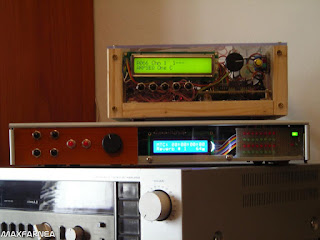
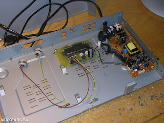
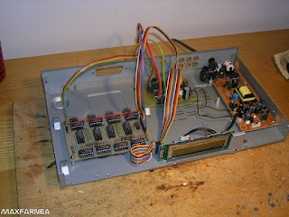

# THE MIDIBOX PLATFORM

*Published: 2016-06-16*

**Tag:** sintetizzatore, do it yourself, DIY, MIDI, programmazione, elettronica, microcontrollori, fai da te

---

The **MIDIbox** platform is an opensource hardware and software project by **Thorsten Klose** for the self-construction of non-commercial **MIDI** systems (processors, controllers, sequencers or expander modules) that nonetheless offer professional functions and performance.

It is a long-lived and mature architecture born in 1998 and in continuous development and updating, and the related community is also well established by now.

  

At a macroscopic level, the MIDIbox system consists of a hardware core module to which other cores or specific input/output modules (digital, analog, CV, MIDI), display modules (LED or display) or sound generation modules (MOS **SID** or Yamaha **OPL3**) can be connected. The hardware is driven by a true realtime MIDI operating system (called **MIOS**) that provides the basic communication functions (MIDI, USB, etc.), user interface and display management, and patch editing and saving. On top of MIOS, specific firmware is built for each type of instrument one wants to create.

  

  

  

Surely when talking about a core module to which specific modules can be connected, **Arduino** and its shields come to mind, and one might wonder why there are users who use this platform instead of the Made in Italy board, and also what this architecture offers that is different. Well, MIDIbox is almost 20 years old and was therefore born and spread when Arduino did not yet exist; but it's not just a chronological matter — the entire project is specific to the creation of MIDI systems, so both hardware and software are optimized for use in a musical context. The performance is impressive (latency goes below a millisecond) and the hardware's potential allows for functions and a user interface comparable to commercial products.

  

Since this is a **DIY** platform where you have to build the hardware yourself, customize the firmware, compile it, and transfer it to the microcontroller, this might intimidate and disorient a maker who is tackling self-construction of a complete MIDI/audio system for the first time. However, the website comes to the rescue on this aspect, offering detailed documentation on hardware and software, including ready-to-use firmware for standard applications described on the site itself. Furthermore, in the forum and Wiki section there is information about stores or volunteers offering pre-assembled modules or kits, pre-programmed microcontrollers, discussions and ideas about building enclosures for the hardware, links to panel laser-cutting services or PCB manufacturing services.

  

Although born in 1998, the project is very current because it has always evolved over time, taking advantage of advances in microcontrollers. Initially the project offered a core based on a **PIC** microcontroller with MIOS and firmware written in Assembly (although for simple applications it is possible to write firmware in C). Between 2008 and 2010 the system moved to an **STM32** microcontroller and MIOS32, which increased the hardware performance to the point where Assembly language was no longer required. Furthermore, this microcontroller architecture could easily take advantage of USB, Ethernet and SD Card storage support. Then in 2011 support for **LPC17xx** systems was added, and finally in 2013 the **STM32F4** microcontroller joined the family.

  

This continuous evolution should not, however, suggest an unstable architecture that forces constant patches and updates: each upgrade opens the way to new and more complex versions of applications, but the previous ones remain documented and present on the site. Even if it doesn't make much sense financially, nothing would stop you from building a project based on an old PIC microcontroller because it is cheaper or simpler, albeit more limited. I myself built two projects in the early 2000s based on PIC and feel no need to dismantle them and rebuild them with a more powerful microcontroller — of course, if I wanted to build a new system, I would use the more modern cores to have all the advantages in terms of connectivity, expandability and ease of programming.

  

With all that said, I refer you to the site [uCApps.de](http://ucapps.de/) where the entire MIDIbox project is hosted, and I leave you with some videos of systems built by users.

  

