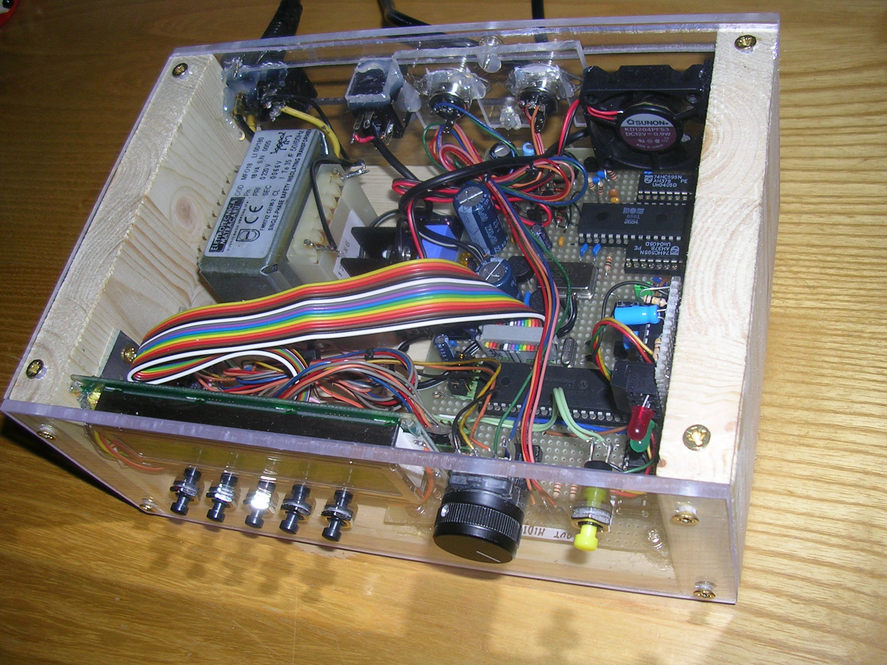

# LA PIATTAFORMA MIDIBOX

*Pubblicato: 2016-06-16*

**Tag:** sintetizzatore, do it yourself, DIY, MIDI, programmazione, elettronica, microcontrollori, fai da te

---

La piattaforma **MIDIbox** è un progetto hardware e software opensource di **Thorsten Klose** per la autocostruzione di sistemi **MIDI** (processori, controller, sequencer o moduli expander) non commerciali ma comunque con funzioni e prestazioni professionali.

E' un'architettura longeva e matura nata nel 1998 e in continuo sviluppo e aggiornamento e anche la relativa community è ormai ben rodata.

A livello macroscopico il sistema MIDIbox consiste in un modulo hardware core al quale si possono collegare altri core oppure specifici moduli di input/output (digitale, analogico, CV, MIDI), di visualizzazione (LED o display) o di generazione sonora (MOS **SID** o Yamaha **OPL3**). L'hardware è pilotato da un vero e proprio sistema operativo realtime MIDI (detto **MIOS**) che offre le funzionalità di base di comunicazione (MIDI, USB, ecc), di gestione dell'interfaccia utente e display e di editing e salvataggio delle patch. Sopra al MIOS sono realizzati i firmware specifici per tipologia di strumento che si vuole realizzare.

  

Sicuramente parlando di modulo core al quale si possono collegare moduli specifici viene in mente **Arduino** e i relativi shield e ci si potrebbe chiedere perché ci siano utenti che utilizzano questa piattaforma anziché la basetta Made in Italy, e anche cosa offra questa architettura di diverso.  Beh, MIDIbox ha quasi 20 anni e quindi è nata e si è diffusa quando Arduino non esisteva ancora; ma non è solo una questione cronologica, infatti tutto il progetto è specifico per la realizzazione di sistemi MIDI e quindi sia hardware che software sono ottimizzati per l'uso in ambito musicale. Le prestazioni sono di tutto rispetto (si scende anche sotto il millisecondo di latenza) e le potenzialità dell'hardware permettono di realizzare funzioni e un'interfaccia utente paragonabile a quella dei prodotti commerciali.   

Trattandosi di una piattaforma **DIY** in cui ci si deve costruire l'hardware, customizzare il firmware, compilarlo e trasferirlo nel microcontrollore, questa potrebbe spaventare e disorientare un maker che si cimenta per la prima volta nella autocostruzione di un sistema MIDI/audio completo. Però su questo aspetto viene in aiuto il sito, che offre una documentazione dettagliata sull'hardware e il software, compresi firmware già pronti all'uso per le applicazioni standard descritte sul sito stesso. Inoltre nel forum e nella sezione Wiki ci sono informazioni a store o volontari che offrono moduli già assemblati o in kit, microcontrollori già programmati, discussioni e idee in merito alla realizzazione di contenitori in cui inserire l'hardware, link a servizi di lasercutting di pannelli o di realizzazione dei circuiti stampati. 

Sebbene sia nato nel 1998, il progetto è molto attuale perché si è sempre evoluto nel tempo traendo vantaggio dall'evoluzione dei microcontrollori. Inizialmente il progetto offriva un core basato su microcontrollore **PIC** con MIOS e firmware realizzato in Assembly (anche se è possibile per applicazioni semplici programmare dei firmware in C). Tra il 2008 e il 2010 il sistema è passato a un microcontrollore **STM32** e MIOS32 e questo ha aumentato le prestazioni dell'hardware da non costringere più all'utilizzo del linguaggio Assembly. Inoltre l'architettura con questo microcontrollore ha potuto facilmente avvantaggiarsi del supporto di porte USB, Ethernet e storage su SD Card. Poi nel 2011 si è aggiunto il supporto a sistemi **LPC17xx** e infine nel 2013 si è aggiunto alla famiglia il microcontrollore **STM32F4**. 

Questa continua evoluzione però non deve far pensare a un'architettura instabile che costringa a continue patch e aggiornamenti: ogni upgrade apre la strada a nuove e più complesse versioni delle applicazioni ma le precedenti rimangono documentate e presenti sul sito. Anche se a conti fatti non conviene, nulla vi vieterebbe di realizzare un progetto basato su un vecchio  microcontrollore PIC perché più economico o più semplice sebbene più limitato. Io stesso ho realizzato due progetti nei primi anni del 2000 basati su PIC e non sento la necessità di smantellarli e ricostruirli con un microcontrollore più potente, certo è che qualora volessi realizzare un nuovo sistema andrei ad utilizzare i core più moderni per avere tutti i vantaggi a livello di connettività, espandibilità e semplicità di programmazione. 

Detto tutto questo vi rimando al sito [uCApps.de](http://ucapps.de/) dove è ospitato tutto il progetto MIDIbox e vi lascio con alcuni video di sistemi realizzati dagli utenti.   

