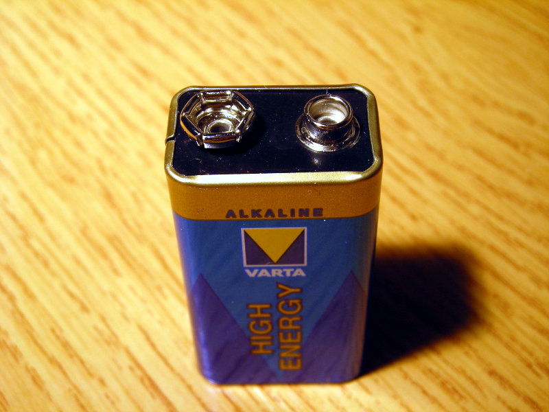
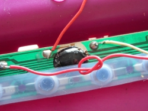
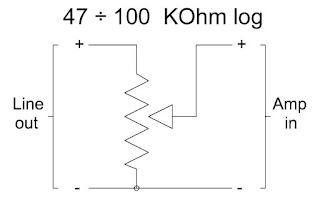

# COMPLETE GUIDE TO CIRCUIT BENDING (WORKSHOP)

*Published: 2016-07-12*

**Tag:** circuit, circuitbending, sperimentale, micromusic, glitch, DIY, workshop, sperimentazione, noise, guida, tutorial

---

During the Path Festival 2015 in Verona, I held a circuit bending workshop at [Interzona](http://www.izona.it/).

  

To support the course I produced a small handout to use as a guide during the day, and now I've decided to revise it for the blog and publish it. For the outline I drew inspiration from the simple introduction to circuit bending that I had already written [[circuit-bending-semplice.en|here]] and expanded its contents to cover all the concepts that characterize this type of practice.

  

I won't
 be referencing specific theoretical notions and no knowledge of
 electronics is required to approach the
technique I am going to explain. I will nonetheless call electronic
 components and circuits by their name, because it's right to start
 getting used to certain terminology and knowing the names of the objects
 that are part of our experiments, in case one wants to
 dig deeper. I myself will try to publish guides and projects on this blog to support those who want to take their first steps in the world of practical electronics.

  

Here is the text of the handout — enjoy reading.

**  
**

**Introduction**

  

In brief, circuit bending (hereafter CB) is the activity through which experimental musical instruments (generally lo-fi, noise) are created by altering and causing faults in electronic circuits of devices originally designed for other purposes. This technique aims to encourage **creativity**, **exploration** and **experimentation**, setting aside advanced electronics knowledge in favor of a direct, instinctive and spontaneous manipulation of circuits.  
**CB is also an excellent training ground and starting point for anyone who wants to expand their experience toward genuine electronic DIY**.  
The practice of circuit bending has also developed as a philosophy oriented toward the reuse and recycling of obsolete and unused electronic equipment (generally toys, radios, tape players, consoles), giving them a second life in a creative context.** **  

  

  

**Safety Rules**  

  

The operational freedom that characterizes circuit bending should not, however, make us think that there are no rules. There are a few very important rules that must never be overlooked because they concern our safety while we manipulate electrical circuits, with which we often come into direct contact and whose operation we don't know. Without some fundamental precautions, one's safety is seriously endangered.  
**The main rule of CB is to always use battery-powered devices**. This is a fundamental rule, because the electric current involved can be a mortal danger. In general it is not a problem because electrical devices are designed to work safely, but by disassembling and tampering with circuits we expose ourselves fully to the risk of electric shocks.  
External power supplies should also be avoided since they never guarantee 100% isolation from the mains: they can themselves be faulty or defective because they are old or overloaded by the short circuits we inadvertently apply to circuits during our investigation. If we work outdoors or during a live concert, the power supply could get wet and compromise electrical isolation.  
For the same reasons, care must be taken — or better, avoided at least during the circuit exploration phase — when connecting the toy or device we are manipulating to a sound reinforcement system or mixer powered by mains voltage.  
A second safety rule requires us to **never allow electric current to pass through vital organs, especially the heart**, even if I am working with the low voltages of batteries. In CB one often explores a circuit by touching it directly with the fingers — indeed, many times the resistance of our skin alone is sufficient to interestingly alter the electrical parameters of the circuit. While doing this we must avoid using both hands, thus preventing the circuit from closing through our body, passing for example through the heart. Certainly the currents involved are not lethal or flow mainly on the surface of the skin, but they can in some cases cause small stresses to our tissues that are better avoided.** **  

  

  

**Materials**  

  

Since we need to disassemble small electrical devices, a suitable set of screwdrivers is needed, perhaps also for Torx screws which are increasingly common. **Alligator clips** are also essential for making the first tests with loose connections.  
Then it will also be necessary to do some soldering, so it is better to get a pencil soldering iron, safety glasses, solder, tweezers and a wire stripper. Finally, one must budget for the electrical materials needed to finalize the modifications we want to make: switches, pushbuttons, potentiometers, jack sockets, electrical contacts.** **  

  

  

**What to Choose**

  

Bearing in mind that it's worth trying a bit of everything we can get our hands on, there are some considerations that help us understand from the outset what we can expect to get from a circuit or how far we can manage to intervene on it.  
A fundamental element is the period in which the toy or instrument in our hands was built. **Technology from the 80s or 90s is ideal** because there is not such miniaturization and integration as to make circuit access and manipulation difficult. Even in the presence of digital circuits, there are no sophisticated configurations that might react to our interventions by trying to correct them or even by resetting or locking up the circuit. In these cases, beyond being able to intervene on the pitch of the sounds, one can also create anomalies in the instrument's memory, causing the classic **glitches**. On the other hand, over time these circuits increasingly acquire a collectible value because they are vintage or precisely because they are sought after in experimental circles for circuit bending.  
Being very passionate about retrocomputing and electronics, I try to avoid modifying toys that are becoming rare, or at least avoid invasive and irreversible interventions. But that is my personal choice, which I do not intend to impose on anyone.  

  

Another factor is the price range: cheap toys, especially modern ones, are made with simple circuits consisting of a single 'all in one' chip (COB), usually fused and sealed directly onto the PCB and difficult to access except for a few external passive components. Usually the most we can achieve is a pitch variation or a distortion of the audio output. However, they can work very well for initial tests, since if we irreparably damage the circuit, we won't have lost much.  
CB can also be applied to video circuits, provided they are battery-powered. Other more complex types of circuits, such as computers, video game consoles, professional electronic instruments, often require equipment and experience that inevitably takes us from a CB context to a more technical and planned one called **modding**.  
** **  

  

**Basic Technique**

  
To illustrate the basic CB technique, let's assume we have an electronic sound toy in our hands. We start by disassembling the toy **being careful not to detach any wire** or break the casing. It's a good idea to **take a few photos with your phone during disassembly** to make reassembly easier, especially if a wire should come loose. We should try to lay out the disassembled parts on the table in a way that also allows us to power them up and turn them on.  
We will mainly work on the side of the circuit with the solder joints, so we will probably also need to remove the PCB (without detaching any wires) from the casing.  
With the circuit on, we begin to **touch the contacts with the fingertips** of one hand. We can also slightly moisten the tips of our fingers. While touching the solder joints we can also press the toy's buttons to produce sounds and hear if there are any variations.  
What do we expect? **By altering the resistance in certain parts of the circuit with our skin, we can expect pitch variations or buzzing due to grounds or feedback**. If there is some effect we like, we can mark with a permanent marker a point near the solder joints we touched so as to find them again later.  
Another way to proceed is via alligator clips. One end of the clip is attached to a contact on the circuit, while the other end is used to touch all the contacts present on the PCB. If there is a complete power drop (short circuit), if components start to get very hot, or if very loud crackling noises occur relative to the normal volume, it is better to leave alone the area we are touching or the point to which we have connected the clip.  
In general one starts by connecting a clip to one power supply wire, then moves it to the other, and gradually searches for other wires or pads (that's what the points where components are soldered are called). Probing the circuit with the clip connected to one pole of the power supply is useful when dealing with digital circuits, as by doing so one directly sets bits 0 or 1, altering the content of the digital information and generally causing glitches. Another interesting test consists of connecting a clip to one pole of the speaker and probing the circuit with the other end.  
**The clip always behaves like an ideal conductor, therefore it creates a short circuit between the points where it is inserted**. Sometimes this can be fine; other times it may be more effective to limit the current flow by using 2 wires joined together with a [**resistor**](https://it.wikipedia.org/wiki/Resistore) in between — so as before we connect the free end of one wire to a point on our circuit and use the free end of the other wire to explore the rest of the circuit. If desired, a [**potentiometer**](https://it.wikipedia.org/wiki/Potenziometro) can be used, which is nothing more than a variable resistor. The potentiometer has three contacts; we use the center one and one of the two outer ones (depending on which one we choose, the resistance varies clockwise or counterclockwise).  
  
** **  

**Consolidating the Sounds**

  
To finalize the sounds discovered, solder pieces of wire at the points we had touched and marked with the marker. At this point we have several options: if the effect was obtained by touching the circuit with our fingers, then we can attach studs or small iron bolts to the wires (I for example find cheap **binder clips** work well) so that they can be fixed to the toy's casing and touched with the fingers of one hand; alternatively, switches or pushbuttons can be soldered to enable the modifications when desired; finally, a potentiometer or a **photoresistor** can be mounted if the effect of our modification can be changed by varying the resistance. The photoresistor has only 2 terminals like a normal resistor, except it is transparent and its resistance varies according to the amount of light hitting it.  

Then to connect the toy to a mixer or amplifier, one option is first of all to **mic it** as if it were an acoustic instrument — even a small PC-type microphone mounted directly on top of the speaker or behind it, inside the casing, will do. Alternatively, **an audio jack socket can be soldered in place of the speaker**, perhaps also adding a potentiometer to regulate the volume level according to the following diagram:  

  

  

When we are satisfied with our work, it is better to reassemble the entire casing to prevent any wires from coming loose or undesired contacts from forming during use.  
****  

  

  

**Beyond the Basic Technique: modding**

  
The basic technique is useful for getting comfortable with manipulating electrical circuits and still achieving good results. The time comes when for a certain toy we want a specific effect at all costs or something more. At this point it is better to start planning our interventions.  

  

Obviously at this point some practice with the soldering iron and a minimum ability to read a simple electronic circuit in order to reproduce it are required.  

    

For example, there are toys or entry-level musical instruments that have a [**crystal oscillator**](https://it.wikipedia.org/wiki/Oscillatore_al_cristallo): the presence of the crystal, which is normally appreciated because it makes the oscillation frequency fixed and extremely stable, in our case becomes a problem because we cannot alter the pitch by touching the circuit or adding a potentiometer; we must instead replace the crystal with one of a lower frequency and switch between them via a switch. Alternatively, for those who need to make such modifications, variable oscillators are commercially available to be mounted in place of the crystal to allow pitch variation at will — for example the **[LTC1799](https://www.google.it/?client=firefox-b#q=LTC1799&gfe_rd=cr)** (just search for this part number on Google to find everything you need about it).  

  

Or we may want to **simulate depleted batteries**, which sometimes cause interesting distortions and pitch variations. For this effect one should look up the modification called **Power Starve**, whose schematic can also be found online.  

  

The more demanding might want to **control the modifications made to the toy via MIDI** in order to manage them through a controller or software. Even in this case there are circuits, generally called **MIDI retrofit kits**, which when mounted in place of our potentiometers and switches simulate their operation based on MIDI messages they receive at their input.  

  

Other more sophisticated modifications involve the insertion of actual circuits (called **step sequencers**) that switch the modifications based on programmable patterns — and here we enter the realm of self-construction, with actual projects to build such as the one proposed by **Casper Electronics** [here](http://casperelectronics.com/finished-pieces/sequencers/step-sequencer/).  

  

  

**Conclusions**  

  

As already stated, CB is not a procedure or a simple theory to apply: it is an approach for informally engaging with electronic experimentation. It can be seen as a simple game or the starting point of your own personal exploratory and educational journey. It all depends on you.
