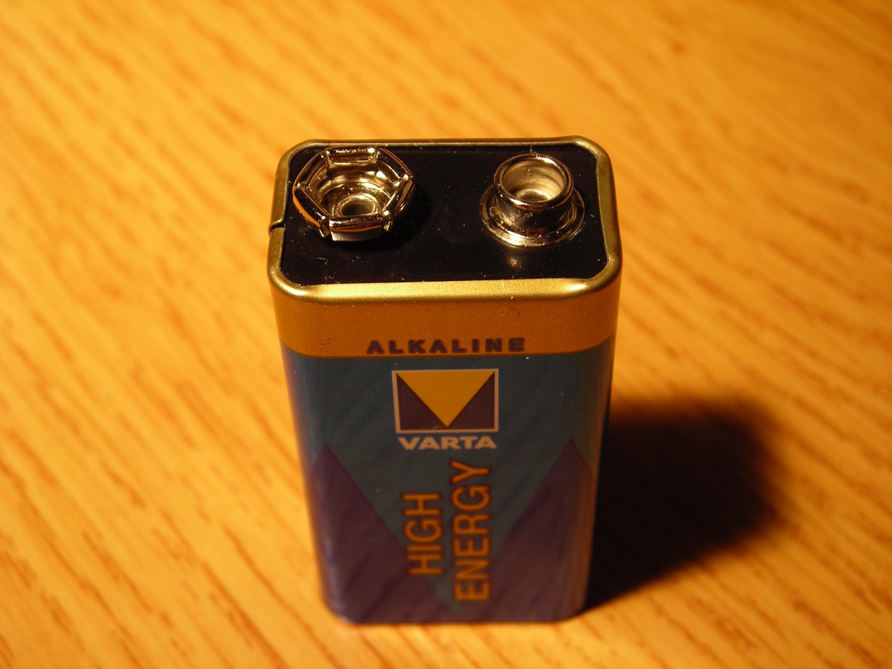
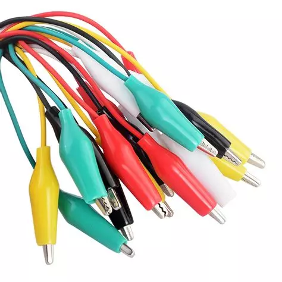
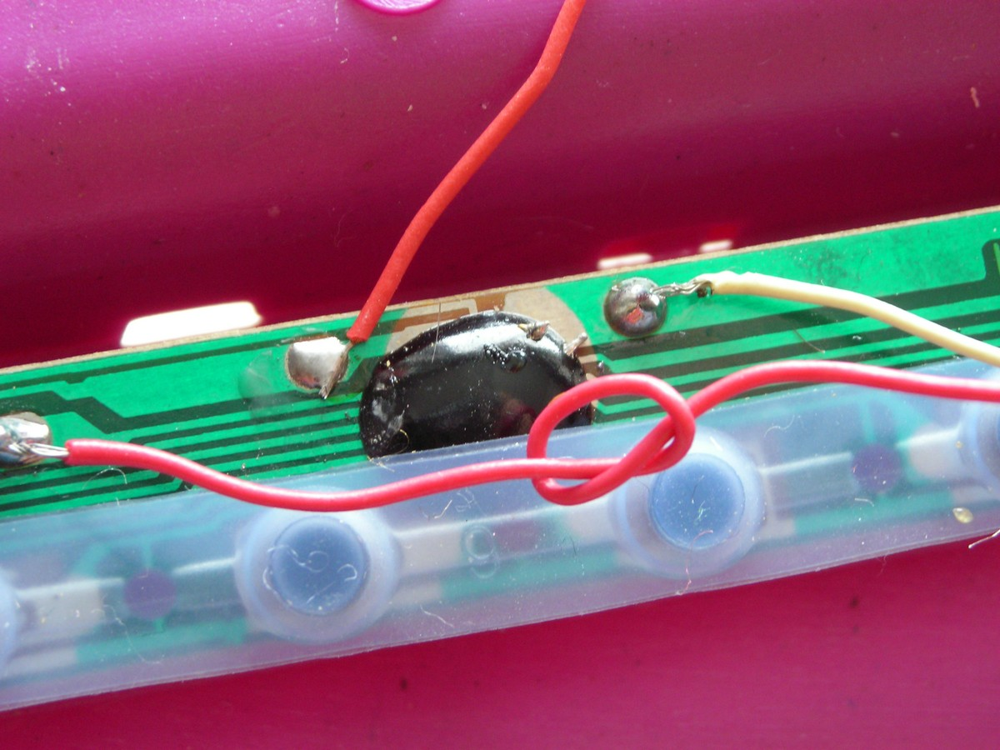
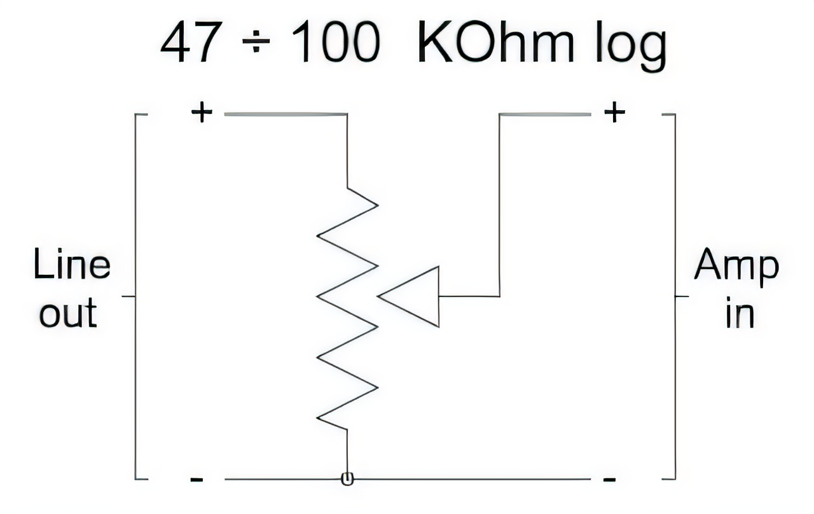

# COMPLETE GUIDE TO CIRCUIT BENDING (WORKSHOP)

*Published: 2016-07-12*

**Tags:** circuit, circuitbending, experimental, micromusic, glitch, DIY, workshop, experimentation, noise, guide, tutorial

---

During Path Festival 2015 in Verona, I held a circuit bending workshop at [Interzona](http://www.izona.it/).

To support the course, I produced a small handout to use as a guide during the day, and now I have decided to re-edit it for the blog and publish it. For the content, I took inspiration from the simple introduction to circuit bending that I had already written [here](../20121211/circuit-bending-semplice.md) and expanded the content to include all the concepts that characterize this type of practice.

I will not refer to specific theoretical notions, and no knowledge of electronics is required to approach the technique I am going to explain. However, I will still call electronic components and circuits by their names because it is right to start getting used to certain terminology and knowing the names of the objects that are part of our experiments, in case you want to delve deeper. On this blog, I will also try to publish guides and projects to support those who want to take their first steps in practical electronics.

Here is the text of the handout. Enjoy reading.

#### Introduction

In brief, circuit bending (hereafter CB) is the activity of creating experimental musical instruments (usually lo-fi, noise) by altering and causing malfunctions in electronic circuits of devices generally designed for other purposes. This technique aims to encourage **creativity**, **exploration**, and **experimentation**, setting aside advanced notions of electronics in favor of direct, instinctive, and spontaneous manipulation of circuits.

**CB is still an excellent training ground and starting point for anyone who wants to expand their experience toward true DIY electronics.**

The practice of circuit bending has also developed as a philosophy oriented toward the reuse and recycling of obsolete and unused electronic equipment (usually toys, radios, tape recorders, consoles), giving them a second life in a creative context.

#### Safety Rules

The operational freedom that characterizes circuit bending should not make us believe that there are no rules. There are a few very important rules that must never be neglected because they concern our safety while we manipulate electrical circuits, with which we often come into direct contact, and whose operation we do not understand. Without fundamental precautions, we seriously endanger our own safety.

**The main rule of CB is to always use battery-powered devices.** This is a fundamental rule because the electric current involved can be a mortal danger. Generally, this is not a problem because electrical devices are designed to operate safely. However, when we disassemble and tamper with circuits, we expose ourselves completely to the risk of electric shocks.

External power supplies should also be avoided because they never guarantee 100% isolation from the electrical grid: they may themselves be faulty or defective due to age or overload from short circuits that we inadvertently apply to the circuits during our investigation. If we work outdoors or during a live concert, the power supply could get wet and compromise electrical isolation.

For the same reasons, we should be careful—or better, avoid at least during the exploration phase of circuits—to connect the toy or device we are manipulating to an amplification system or mixer powered by mains voltage.

A second safety rule requires us **never to allow electric current to pass through vital organs, especially the heart**, even if we are working with the low voltages of batteries. Often in CB, a circuit is explored by touching it directly with the fingers. In fact, many times the resistance of our skin is sufficient to interestingly alter the electrical parameters of the circuit. When doing this, we must avoid using both hands, preventing the circuit from closing through our body, for example, passing through the heart. Certainly, the currents involved are not lethal or flow mainly on the surface of the skin, but they can, in some cases, cause minor stress to our tissues, which is better to avoid.

#### Materials

Since we need to disassemble small electronic devices, a suitable set of screwdrivers is required, perhaps even for Torx screws, which are increasingly common. **Alligator clips** are also essential for making initial tests with temporary connections.

Then, soldering will be necessary, so it is best to get a soldering iron, protective glasses, solder, tweezers, and wire strippers. Finally, you should budget for the electrical materials needed to finalize the modifications you want to make: switches, buttons, potentiometers, jack sockets, electrical contacts.

#### What to Choose

While it is worth trying a bit with everything we can recover, there are considerations that help us understand from the start what we can expect to obtain from a circuit or how far we can intervene on it.

A fundamental element is the period in which the toy or instrument we have in our hands was built. **Technology from the 80s or 90s is ideal** because there is no such miniaturization and integration that makes accessing and manipulating circuits difficult. Even in the presence of digital circuits, sophisticated configurations are not found that could react to our interventions by trying to correct them or even resetting or locking up the circuit. In these cases, we can also intervene on the pitch of sounds or create anomalies in the device's memory, causing the classic **glitches**. On the other hand, these circuits often become increasingly collectible over time because they are vintage or sought after in the experimental field for circuit bending.

I am very passionate about retrocomputing and electronics, so I try to avoid modifying toys that are becoming rare or, at least, avoid invasive and irreversible interventions. But this is a personal choice that I do not intend to impose on anyone.

Another factor is the price range: cheap toys, especially modern ones, are made with simple circuits, consisting of a single all-in-one chip (COB), usually fused and sealed on the same printed circuit board, and difficult to access except for a few external passive components. Usually, the maximum we can achieve is a pitch variation or distortion of the audio output. However, they can be very good for initial tests, as if we irreparably damage the circuit, we will not have lost much.

CB can also be applied to video circuits, as long as they are battery-powered. Other more complex types of circuits, such as computers, video game consoles, or professional electronic instruments, often require equipment and experience that inevitably takes us from a CB context to a more technical and planned one, called **modding**.

#### Basic Technique

To illustrate the basic technique of CB, let's assume we have an electronic sound toy in our hands. We start by disassembling the toy, **taking care not to detach any wires** or break the casing. It's a good idea to **take some photos with your phone during disassembly** to facilitate reassembly, especially if any wires should come loose. We must try to arrange the disassembled parts on the table in a way that allows us to power and turn them on.

We will mainly work on the side of the circuit with the soldering, so we will probably also need to remove the printed circuit board (without detaching any wires) from the casing.

With the circuit turned on, we begin to **touch the contacts with the fingertips** of one hand. We can also slightly moisten the tips of our fingers. While touching the soldering points, we can also press the toy's buttons to produce sounds and hear if there are any changes.

What can we expect? **By altering the resistance in some parts of the circuit with our skin, we can expect pitch variations or buzzes due to grounding or feedback.** If there is any effect we like, we can mark a point near the soldering points we touched with an indelible marker to find them later.

Another way to proceed is using alligator clips. One end of the clip is attached to a contact on the circuit, while the other end is used to touch all the contacts present on the printed circuit. If there is a total drop in power (short circuit), if the components start to heat up a lot, or if very loud crackles occur compared to the normal volume, it's best to leave the area we are touching or the point to which we have connected the clip alone.

Generally, we start by connecting one clip to a power supply wire and then switch it to the other, and then gradually look for other wires or pads (these are the points where components are soldered). Probing the circuit with the clip connected to one power pole is useful when dealing with digital circuits, as this directly sets the bits to 0 or 1, altering the digital information content and generally causing glitches. Another interesting test consists of connecting a clip to one pole of the speaker and probing the circuit with the other end.

**The clip always behaves like an ideal conductor, thus creating a short circuit between the points where it is inserted.** Sometimes this can be fine, but other times it may be more effective to limit the current flow by using two wires joined together, inserting a **[resistor](https://en.wikipedia.org/wiki/Resistor)** in between. So, as before, we connect the free end of one of the wires to a point in our circuit and use the free end of the other wire to explore the rest of the circuit. If desired, a **[potentiometer](https://en.wikipedia.org/wiki/Potentiometer)** can be used, which is essentially a variable resistor. The potentiometer has three contacts: use the center one and one of the two outer ones (depending on which you choose, the resistance varies clockwise or counterclockwise).

#### Consolidating the Sounds

To finalize the discovered sounds, pieces of wire must be soldered to the points we had touched and marked with the marker. At this point, we have several options: if the effect was obtained by touching the circuit with our fingers, then we can attach studs or small iron bolts to the wires (I, for example, find the inexpensive **bind posts** work well) so that they can be fixed to the toy's casing and touched with the fingers of one hand. Alternatively, switches or buttons can be soldered to enable the modifications when desired. Finally, a potentiometer or a **photoresistor** can be installed if the effect of our modification can be changed by varying the resistance. The photoresistor has only 2 terminals like a normal resistor, except that it is transparent and its resistance varies depending on the amount of light that hits it.

Then, to connect the toy to a mixer or amplifier, you can first mic it as if it were an acoustic instrument—even with a small PC microphone mounted directly above or behind the speaker, inside the casing. Alternatively, **you can solder a female audio jack connector in place of the speaker**, perhaps also adding a potentiometer to adjust the volume level according to the following diagram:

When we are satisfied with our work, it is best to reassemble the entire casing to prevent wires from detaching or unwanted contacts from being created during use.

#### Beyond the Basic Technique: Modding

The basic technique is useful for becoming familiar with the manipulation of electrical circuits and still obtaining good results. However, there comes a point when, for a particular toy, we want a specific effect at all costs or something more. That's when we need to start planning our interventions.

Obviously, at this point, some practice with the soldering iron and a minimum ability to read a simple electronic circuit to reproduce it are required.

For example, there are toys or entry-level musical instruments that have a **[crystal oscillator](https://en.wikipedia.org/wiki/Crystal_oscillator)**: the presence of the quartz, which is usually appreciated because it makes the oscillation frequency fixed and extremely stable, becomes a problem in our case because we cannot alter the pitch by touching the circuit or adding a potentiometer. We must necessarily replace the quartz with one of a lower frequency and switch from one to the other using a switch. Alternatively, there are commercial oscillators specifically for those who need to make these modifications—variable oscillators to mount in place of the quartz to vary the pitch at will, such as the **[LTC1799](https://www.google.com/?client=firefox-b#q=LTC1799&gfe_rd=cr)** (just search for this code on Google to find everything you need).

Or we may want to **simulate low batteries**, which sometimes cause interesting distortions and pitch variations. For this effect, you should refer to the modification called **Power Starve**, whose diagram can also be found online.

The most demanding users might want to **control the modifications made to the toy via MIDI** to manage them through a controller or software. In this case, there are also circuits—usually called **MIDI retrofit kits**—which, when mounted in place of our potentiometers and switches, simulate their operation based on MIDI messages they receive as input.

Other more sophisticated modifications involve inserting actual circuits (called **step sequencers**) that switch the modifications based on programmable patterns. This brings us into the field of DIY, with actual projects to create, such as the one proposed by **Casper Electronics** [here](http://casperelectronics.com/finished-pieces/sequencers/step-sequencer/).

#### Conclusions

As already stated, CB is not a procedure or a simple theory to apply: it is an approach to informally approach electronic experimentation. It can be seen as a simple game or the starting point of your personal exploratory and educational journey. It depends only on you.
