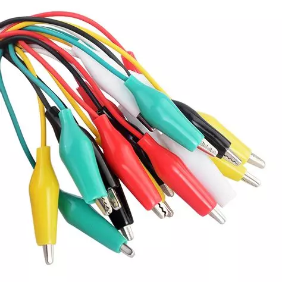

# GUIDA COMPLETA AL CIRCUIT BENDING (WORKSHOP)

*Pubblicato: 2016-07-12*

**Tag:** circuit, circuitbending, sperimentale, micromusic, glitch, DIY, workshop, sperimentazione, noise, guida, tutorial

---

Durante il Path Festival 2015 a Verona, ho tenuto un workshop sul circuit bending presso [Interzona](http://www.izona.it/).

A sostegno del corso ho prodotto una piccola dispensa da usare come scaletta durante la giornata e ora ho deciso di rieditarla per il blog e pubblicarla. Per la traccia ho preso spunto dalla semplice introduzione al circuit bending che avevo già scritto [qui](../20121211/circuit-bending-semplice.md) e ne ho esteso i contenuti in modo da comprendere tutti i concetti che caratterizzano questo tipo di pratica.   

Non farò riferimento a nozioni teoriche specifiche e non è richiesta nessuna conoscenza di elettronica per avvicinarsi alla tecnica che andrò ad esporre. Chiamerò comunque i componenti elettronici e i circuiti con il loro nome, perché è giusto  iniziare ad abituarsi ad una certa terminologia e sapere il nome degli oggetti  che fanno parte delle nostre sperimentazioni nel caso si volesse approffondire. Io stesso su questo blog cercherò di pubblicare guide e progetti a supporto di chi avesse voglia di muovere i primi passi nell'ambito dell'elettronica pratica.  

Ecco il testo della dispesa, buona lettura.

#### Introduzione

In breve il circuit bending (in seguito CB) è l'attività con la quale si creano strumenti musicali sperimentali (in genere lo-fi, noise) alterando e causando avarie a circuiti elettronici di dispositivi generalmente nati per altri scopi. Questa tecnica vuole incentivare **la creatività**, **l'esplorazione** e **la sperimentazione**, tralasciando nozioni avanzate di elettronica a favore di una manipolazione diretta dei circuiti, istintiva e spontanea.  
**Il CB è comunque un'ottima palestra e punto di partenza per chiunque volesse espandere la propria esperienza verso un vero e proprio fai da te elettronico**.  
La pratica del circuit bending si è sviluppata anche come filosofia orientata al riuso e riciclo di apparecchiature elettroniche obsolete e inutilizzate (in genere giocattoli, radio, mangianastri, console), dandogli così una seconda vita in un  contesto creativo.

#### Regole di Sicurezza

La libertà operativa che caratterizza il circuit bending non deve però farci credere che non esistano regole. Esistono poche regole importantissime che non si devono mai trascurare perché riguardano la nostra incolumità mentre manipoliamo circuiti elettrici, con cui spesso veniamo anche in diretto contatto, e di cui ignoriamo il funzionamento. Senza degli accorgimenti fondamentali si mette seriamente in pericolo la propria incolumità.  
**La regola principale del CB è quella di utilizzare sempre apparecchi alimentati a batterie**. Questa è una regola fondamentale, perché la corrente elettrica in gioco può essere un pericolo mortale. In genere essa non è un problema perché i dispositivi elettrici sono progettati per lavorare in sicurezza, ma noi andando a smontare e manomettere i circuiti ci esponiamo completamente a rischi di scosse elettriche.  
Si devono evitare anche gli alimentatori esterni in quanto non garantiscono mai un isolamento al 100% dalla rete elettrica: possono essere a loro volta guasti o difettosi perché vecchi o sovraccaricati dai corto circuiti che involontariamente applichiamo ai circuiti durante la nostra indagine. Se lavoriamo all'aperto o durante un concerto live l'alimentatore potrebbe bagnarsi e compromettere l'isolamento elettrico.  
Per gli stessi motivi si deve fare attenzione, o meglio evitare almeno in fase di esplorazione dei circuiti, a collegare il giocattolo o l'apparecchio che stiamo manipolando ad un impianto di amplificazione o mixer alimentato con la tensione di rete.  
Una seconda regola di sicurezza ci impone di **non permettere mai alla corrente elettrica di passare attraverso organi vitali, soprattutto il cuore**, anche se sto lavorando con le basse tensioni delle batterie. Spesso nel CB si esplora un circuito toccandolo direttamente con le dita, infatti molte volte è sufficiente la resistenza della nostra pelle per alterare in modo interessante i parametri elettrici del circuito. Facendo questo dobbiamo evitare di usare entrambe le mani, impendendo così che il circuito si chiuda attraverso il nostro corpo, passando ad esempio attraverso il cuore. Sicuramente le correnti in gioco non sono mortali o scorrono principalmente sulla superficie della pelle, però posso causare in alcuni casi piccoli stress ai nostri tessuti che è meglio evitare. 

#### Materiale  

Dovendo smontare piccoli apparecchi elettrici serve un set di cacciaviti adeguati, magari anche per viti Torx che sono sempre più diffuse. Sono anche essenziali dei **morsetti a coccodrillo** per fare le prime prove con collegamenti volanti.  
Poi  sarà necessario fare anche delle saldature, quindi è meglio procurarsi un saldatore a stilo, occhiali di protezione, stagno, una pinzetta e una forbice spelafili da elettricisti. Infine si deve mettere in preventivo il materiale elettrico necessario per finalizzare le modifiche che vorremo fare: interuttori, pulsanti, potenziometri, prese jack, contatti elettrici. 

#### Cosa Scegliere

Fermo restando che vale la pena provare un pò con tutto quello che riusciamo a recuperare, ci sono delle considerazioni che ci aiutano a capire già in principio che cosa possiamo aspettarci di ottenere da un circuito o fino a che punto possiamo riuscire a intervenire su di esso.   
Un elemento fondamentale è il periodo in cui è costruito il giocattolo o lo strumento che abbiamo tra le mani. **Una tecnologia degli anni 80 o 90 è l'ideale** perché non vi è una miniaturizzazione e un'integrazione tali da rendere difficile l'accesso e la manipolazione dei circuiti. Anche in presenza di circuiti digitali, non si trovano configurazioni sofisticate che possono anche reagire ai nostri interventi cercando di correggerli o anche resettando o mandando in blocco il circuito. Si riesce in questi casi oltre che a intervenire sul pitch dei suoni anche a creare delle anomalie nella memoria dello strumento provocando i classici **glitch**. Per contro spesso questi circuiti col passare del tempo acquistano sempre più un valore collezionistico perché vintage o proprio perché ricercati in ambito sperimentale per sottoporli a circuit bending.   
Io essendo molto appassionato di retrocomputing ed elettronica cerco di evitare di modificare giocattoli che stanno diventando rari, o almeno evito interventi invasivi e irreversibili. Ma è una scelta mia personale, che non intendo imporre a nessuno.  

Un altro fattore è la fascia di prezzo: giocattoli economici, specie quelli moderni, sono realizzati con circuiti semplici, costituiti da un solo chip 'all in one' (COB), di solito fuso e sigillato sullo stesso circuito stampato e difficilmente accessibile a parte qualche componente passivo esterno. Solitamente il massimo che riusciamo ad ottenere è una variazione di pitch o una distorsione dell'uscita audio. Però possono andare molto bene per le prime prove, dato che nel caso danneggiassimo in modo irrimediabile in circuito, non ci avremo perso molto.  
Il CB si può applicare anche a circuiti video, fermo restando che devono essere alimentati a batterie. Altri tipi di circuiti più complessi, come computer, console di videogiochi, strumenti elettronici professionali, richiedono spesso un'attrezzatura e un'esperienza che ci porta inevitabilmente da un contesto di CB a uno più tecnico e pianificato che prende il nome di **modding**.  

#### Tecnica di Base

Per illustrare la tecnica base del CB, assumiamo di avere per le mani un giocattolo elettronico sonoro. Si inizia con lo smontare il giocattolo **facendo attenzione a non staccare nessun filo** o rompere la scocca. E' una buona idea **fare qualche foto con il cellulare durante lo smontaggio** per facilitare il rimontaggio, soprattutto se qualche filo dovesse staccarsi. Si deve cercare di disporre le parti smontate sul tavolo in modo che si riesca anche ad alimentarle e ad accenderle.  
Andremo a lavorare principalmente sul lato del circuito con le saldature, quindi probabilmente si dovrà smontare anche il circuito stampato (senza staccare nessun filo) dalla scocca.   
Con il circuito acceso cominciamo a **toccare i contatti con i polpastrelli** di una mano. Possiamo anche inumidirci leggermente la punta delle dita. Mentre tocchiamo le saldature possiamo anche premere i pulsanti del giocattolo per produrre i suoni e sentire se ci sono delle variazioni.  
Cosa ci aspettiamo? **Alterando con la nostra pelle la resistenza in alcune parti del circuito possiamo aspettarci variazioni di pitch o ronzii dovuti a masse o feedback**. Se c'è qualche effetto di nostro gradimento possiamo segnare con un pennarello indelebile un punto vicino alle saldature che abbiamo toccato in modo da ritrovarle in seguito.   
Un altro modo per procedere è quello tramite i morsetti a coccodrillo. Si aggancia un'estremità del morsetto a un contatto del circuito, mentre si tocca con l'altra estremità tutti i contatti presenti sul circuito stampato. Nel caso che ci sia un calo totale dell'alimentazione (corto circuito), che i componenti inizino a scaldare molto, che si producano crepitii molto alti rispetto al volume normale, è meglio lasciare stare la zona che stiamo toccando o il punto a cui abbiamo collegato il morsetto.  
In genere si inizia collegando un morsetto a un filo dell'alimentazione e in seguito lo si passa all'altro e poi via via si cercano altri fili o piazzole (sono così detti i punti dove sono saldati i componenti). Sondare il circuito con il morsetto collegato a un polo dell'alimentazione è utile quando si ha a che fare con circuti digitali, infatti così facendo si impostano direttamente i bit 0 o 1 alterando il contenuto dell'informazione digitale e in genere provocando glitch. Un'altra prova interessante consiste nel collegare un morsetto ad un polo dell'altoparlante e sondare il circuito con l'altra estremità.   
**Il morsetto si comporta sempre come un conduttore ideale, quindi crea un corto circuito tra i punti in cui è inserito**. A volte questo può andare bene, altre volte può essere più efficace limitare il flusso di corrente usando 2 cavetti uniti tra di loro inserirendo in mezzo una [**resistenza**](https://it.wikipedia.org/wiki/Resistore), quindi come prima colleghiamo l'estremità libera di uno dei cavetti ad un punto del nostro circuto e usiamo l'estremità libera dell'altro cavetto per esplorare il resto del circuito. Volendo si può usare un [**potenziometro**](https://it.wikipedia.org/wiki/Potenziometro), che altro non è che una resistenza variabile. Il potenziometro ha tre contatti, usiamo quello centrale e uno dei due esterni (in base a quale scegliamo la resistenza varia in senso orario o antiorario).  
  
#### Consolidare le Sonorità

Per finalizzare i suoni scoperti si devono saldare dei pezzi di filo nei punti che avevamo toccato e segnato con il pennarello. A questo punto abbiamo diverse opzioni:  se l'effetto lo avevamo ottenuto toccando il circuito con le dita, allora possiamo fissare a fili delle borchie o dei piccoli bulloni di ferro (io ad esempio mi trovo bene con degli economici **fermacampione**) in modo da poterli fissare alla scocca del giocattolo e toccarli con le dita di una mano; alternativamente si possono saldare interruttori o pulsanti per abilitare le modifiche quando si desidera; infine si può montare un potenziometro o una **fotoresistenza **qualora l'effetto della nostra modifica si possa modificare al variare della resistenza. La fotoresistenza presenta 2 soli terminali come una resistenza normale, solo che essa è trasparente e la sua resistenza varia in funzione della quantità di luce che la investe.  

Poi per collegare il giocattolo al mixer o a un amplificatore si può per prima cosa microfonarlo come fosse uno strumento acustico, basta anche con un piccolo microfono tipo quelli per PC montato direttamente sopra l'altoparlante o dietro, dentro la scocca. In alternativa **si può saldare un connettore audio jack femmina al posto dell'altoparlante**, magari aggiungendo anche un potenziometro per regolare il livello del volume secondo il seguente schema:  
 

Quando saremo soddisfatti del nostro lavoro è meglio rimontare tutta la scocca per evitare che durante l'utilizzo si stacchi qualche filo o si creino contatti indesiderati.  

#### Oltre la Tecnica di Base, il modding

La tecnica di base è utile per prendere confidenza con la manipolazione di circuiti elettrici e ottenere comunque dei buoni risultati. Arriva poi il momento in cui per un certo giocattolo vogliamo un preciso effetto a tutti i costi o qualcosa di più. Ecco che a questo punto è meglio cominciare a pianificare i nostri interventi.   

Ovviamente a questo punto è richiesta una certa pratica con il saldatore e un minimo di capacità nel leggere un semplice circuito elettronico per poterlo poi riprodurre.   

Ad esempio ci sono giocattoli o strumenti musicali entry level che hanno un [**oscillatore quarzato**](https://it.wikipedia.org/wiki/Oscillatore_al_cristallo): la presenza del quarzo che solitamente è apprezzabile perché rende la frequenza di oscillazione fissa ed estremamente stabile, nel nostro caso diventa un problema perché non riusciamo ad alterare il pitch toccando il circuito o aggiungendo un potenziometro; dobbiamo per forza sostituire il quarzo con uno di frequenza più bassa e passare da uno all'altro tramite uno switch. In alternativa esistono in commercio proprio per chi deve fare queste modifiche, degli oscillatori variabili da montare al posto del quarzo per poter variare il pitch a nostro piacemento come ad esempio l'[**LTC1799**](https://www.google.it/?client=firefox-b#q=LTC1799&gfe_rd=cr) (vi basta cercare questa sigla su Google per trovare tutto quello che vi serve a riguardo).  

Oppure possiamo desiderare di **simulare le pile scariche**, che a volte provocano distorsioni e variazioni di pitch interessanti. Per questo effetto si deve far riferimento alla modifica chiamata **Power Starve** e il cui schema si può trovare sempre in rete.   

I più esigenti potrebbero desiderare di **controllare le modifiche fatte al giocattolo via MIDI** per poterle gestire tramite un controller o un software. Anche in questo caso esistono dei circuiti, in genere chiamati **MIDI retrofit kit**, che montati al posto dei nostri potenziometri e interruttori ne simulano il funzionamento in funzione di messaggi MIDI che ricevono in ingresso.  

Altre modifiche più sofisticate riguardano l'inserimento di veri e propri circuiti (detti **step sequencer**) che commutano le modifiche in base a dei pattern programmabili, e qui entriamo nell'ambito dell'autocostruzione, con veri e propri progetti da realizzare come quello proposto da **Casper Electronics** [qui](http://casperelectronics.com/finished-pieces/sequencers/step-sequencer/).  

#### Conclusioni 

Come già affermato il CB non è una procedura o una semplice teoria da applicare: è un approccio per avvicinarsi in modo informale alla sperimentazione elettronica, può essere visto come un semplice gioco o il punto di partenza di un vostro personale percorso esplorativo e formativo. Dipende solo da voi.
