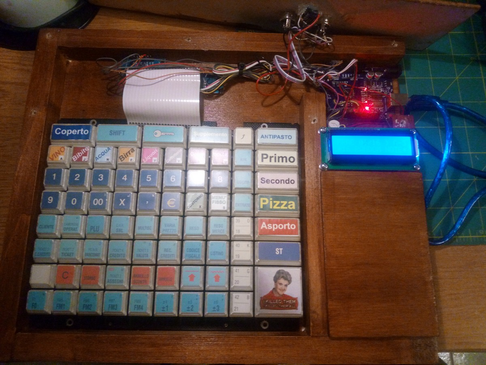
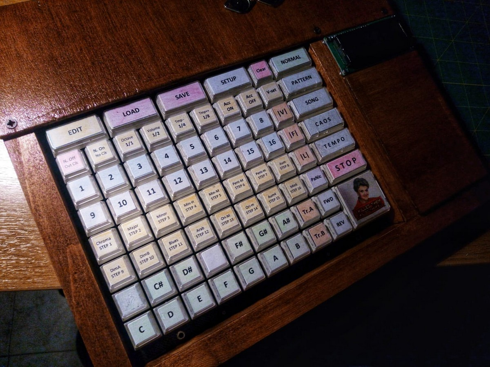

# MACCHINA HARMONIOSA, A GENERATIVE MIDI SEQUENCER WITH ARDUINO

*Published: 2017-06-23*

**Tags:** sounds, project, DIY, do it yourself, download, experimental, DIY, arduino, algorithms, programming, electronics, microcontrollers, MIDI, sequencer

---

Macchina Harmoniosa is a small generative MIDI sequencer/arpeggiator based on Arduino, like many you see in action on YouTube, but with some extra features. And like all the projects I enjoy, it starts with a piece of electronic surplus: its keyboard comes from an old cash register from a restaurant pizzeria, recycled and repurposed. 88 keys, eight rows by eleven columns, managed via two demultiplexer modules connected to Arduino. On top, I mounted a 16x2 LCD display, and since the sequencer works on two tracks, I added two MIDI outputs.

The inspiration to build it came from listening to ***Vertical*** by **Caterina Barbieri**: an album made of minimalist patterns that repeat and transform with hypnotic patience. While listening, at some point, I wanted an instrument that could let me build them.

### Specifications

The sequencer manages **two independent tracks**, each with 16 steps, on separate MIDI channels (default 1 and 2, configurable). Each step has a note, duration (from quarter to sixteenth, in MIDI ticks), and velocity, with accents.

Timing was the first thing I focused on: the machine generates an **internal MIDI master clock at 24 pulses per quarter note**, managed via interrupts, and transmits all clock messages (Start, Stop, Clock) in output. The tempo is continuously variable from 10 to 480 BPM using cursor keys or can be selected from sixteen preset values. The main loop of the program is empty: everything, including execution, is interrupt-driven.

The harmonic part is the heart of the machine:

- **Real-time morphing**: the pattern can be reharmonized on the fly towards **twenty-one different scales**;
- **Real-time transposition** to another tonic, even during playback;
- **Advanced real-time pattern editing**: tempo, note duration, pitch, pattern length, scale, master volume.

The **autogeneration functions** are the most characteristic section and the reason I built it. I used a strictly algorithmic approach, specifically **stochastic** (pattern regeneration with variation probability at 10%, 20%, 33%, or 50%).

I implemented 3 operating modes:

- **Pattern mode**: the pattern loops, and you can regenerate or manually change it whenever you want;
- **Vertical mode**: steps sustain the notes instead of turning them off, towards vertical music, made of drones and layers;
- **Fractal mode**: the machine, at the end of each piece (configurable length in blocks), auto-regenerates the pattern by applying the chosen type of variation on its own: from simple transpositions of individual notes to complete regeneration. Each piece is the child of the previous one and a bit of noise.

Patterns are saved and loaded from Arduino's **EEPROM**, in sixteen banks.

And there is a **PANIC** button that turns off all notes on all channels: when a vertical mode leaves something hanging, or when creativity degenerates.

Playback can also occur in reverse, with the forward and backward keys.

### Technical Details

The seed for the random generator is taken at startup from a free analog input and displayed on the screen, so each power-up is potentially different from the others. The keyboard is scanned row by row by writing the addresses to the demultiplexers and reading the result on a single data pin, with software debounce.

The two tracks play the degrees of the selected scale: the MIDI note is calculated as octave, tonic, and degree, so changing the scale at runtime does not change the pattern but its harmonic "outfit."

