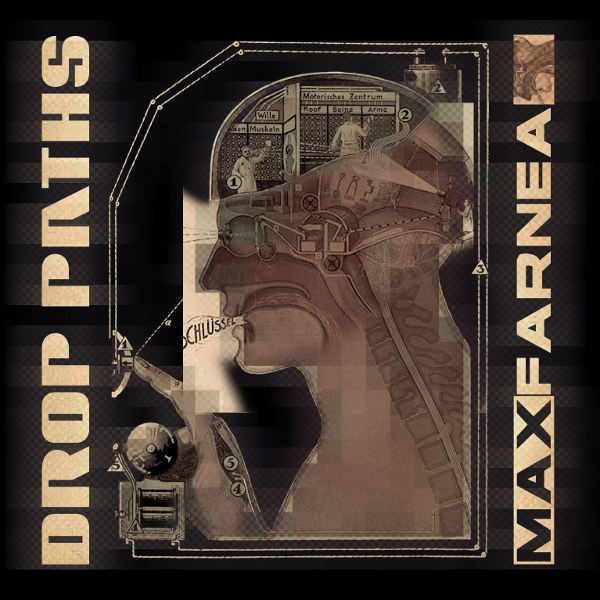

# COMPILATION SOCIAL DISTANCE

*Published: 2021-12-27*

**Tag:** compilation, album, musica

---

Looking at my
[Discogs](https://www.discogs.com/it/artist/2144614-Max-Farnea)
profile I noticed that one of my tracks was included in 2020 in a compilation by
a Chilean netlabel, evidently inspired by the period we are living through.  
I wasn't aware of it, but since that track was released under a
[Creative Commons (by-nc-nd)](https://creativecommons.org/licenses/by-nc-nd/3.0/)
license and the license requirements were satisfied, that's perfectly fine and I'm
happy about it.  
You can listen to it and download it by clicking on the image below.
  

