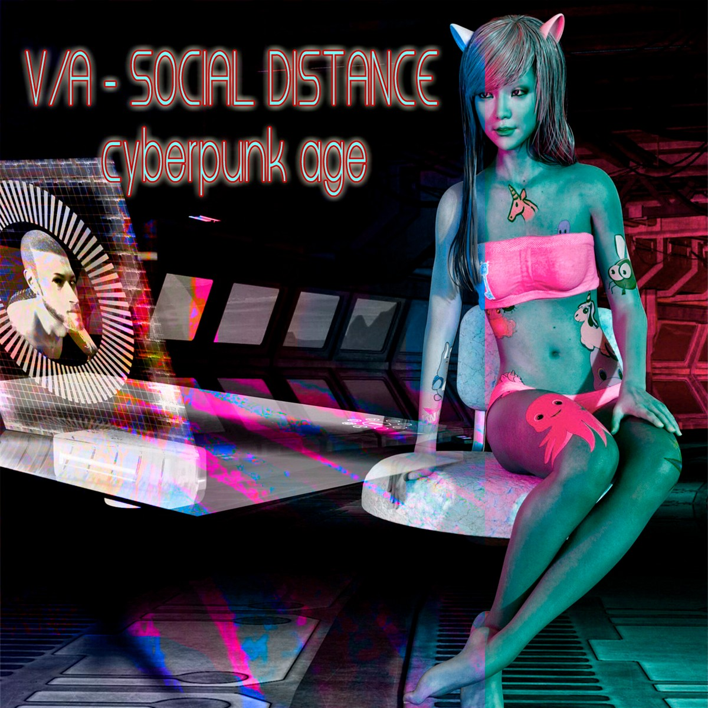

# SOCIAL DISTANCE COMPILATION

*Published: 2021-12-27*

**Tags:** compilation, album, music

---

While looking at my [Discogs](https://www.discogs.com/it/artist/2144614-Max-Farnea) profile, I noticed that one of my tracks was included in a 2020 compilation by a Chilean netlabel, clearly inspired by the times we are living in.

I was not aware of it, but since that track was released under a [Creative Commons (by-nc-nd)](https://creativecommons.org/licenses/by-nc-nd/3.0/) license and the license requirements were satisfied, that's perfectly fine, and I am pleased.

You can listen to it and download it by clicking on the image below.

