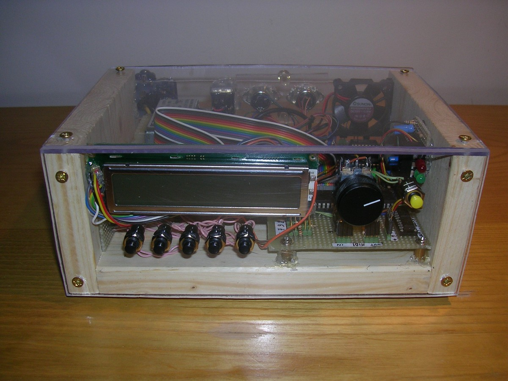
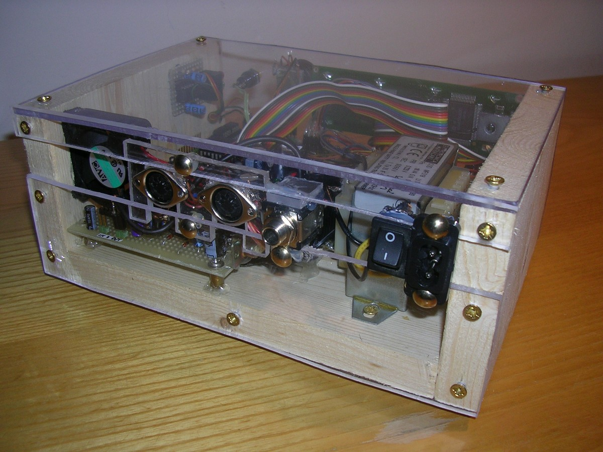
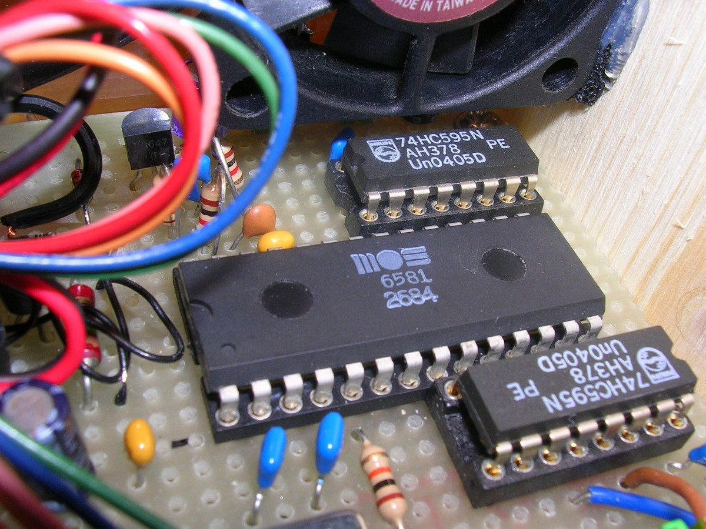

# MIDIBOX SID, THE COMMODORE 64 SOUND CHIP IN A MIDI SYNTH

*Published: 2025-09-10*

**Tags:** synthesizer, do it yourself, DIY, MIDI, programming, electronics, microcontrollers, synth, c64, chiptune

---

The **MOS 6581** is the sound chip of the Commodore 64: three oscillators, a multistate filter, envelope generation, and a sound that for an entire generation meant "video game". In 1982 it was the voice of a home computer; in 2006 I took it out of there and put it at the center of a DIY MIDI synthesizer built on the MIDIbox platform: the **MIDIbox SID**.

The project, developed by Thorsten Klose on the MIDIbox platform, answers a precise question: what happens if the SID is no longer limited by the C64's CPU? The chip's registers are rewritten at **1220 Hz**: on the Commodore 64, music updated the SID registers once per frame, 50-60 times per second, because the 1 MHz 6510 could not do more. The MIDIbox core, a PIC18F452, does it about twenty times faster.

This difference in speed is the whole musical difference: on the C64, software modulations were slow or stepped, here they can be fluid and high resolution.

In addition to the native SID functions (three oscillators with mixable waveforms, sync and ring modulation, low/band/highpass/notch filter), the firmware adds in software:

- **2 extra envelope generators**, with also non-linear curves, assignable to pitch, pulsewidth and filter;
- **6 extra LFOs**, with the same modulation destinations, also combinable for Sample & Hold effects;
- **wavetables and CC sequences** for percussive sounds, combinable with the arpeggiator for complex textures ("a SID *must* have an arpeggiator", the documentation says);
- **Poly, Mono and Legato modes**, **key splitting** for playing the voices separately, portamento, **bassline mode** for those 303 sounds;
- **BankStick** for patches (128 per stick) and an OS-independent SysEx editor.

I built my MIDIbox SID in 2006 on a PIC18F452 core, in the essential configuration: a single SID, a display, one rotary encoder and six buttons to navigate the menus. No forest of knobs: the machine is programmed from the encoder, reading the display, and the patches live on BankStick, 128 per stick.

The machine was born with the **6581**, the original version, the one with the dirty, saturated filter that is the classic C64 sound. Later I modified the power supply (the two SID generations want different voltages) and mounted an **8580**: more faithful and cleaner, and above all the most suitable for bassline mode, which on the 8580 sounds the way it should. It was a sound choice, but also one of necessity: the 6581, in the end, I used to repair a mute C64.

Twenty years later it still turns on and still plays. Not bad, for a chip that in 1982 cost a few dollars and today has a collectors' market.

All the project documentation is on [uCApps.de](http://ucapps.de/): the MIDIbox SID page contains the complete specifications, the sources and demo sounds.

