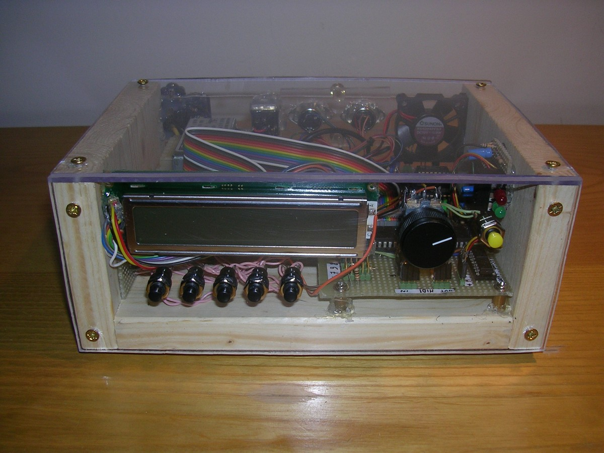
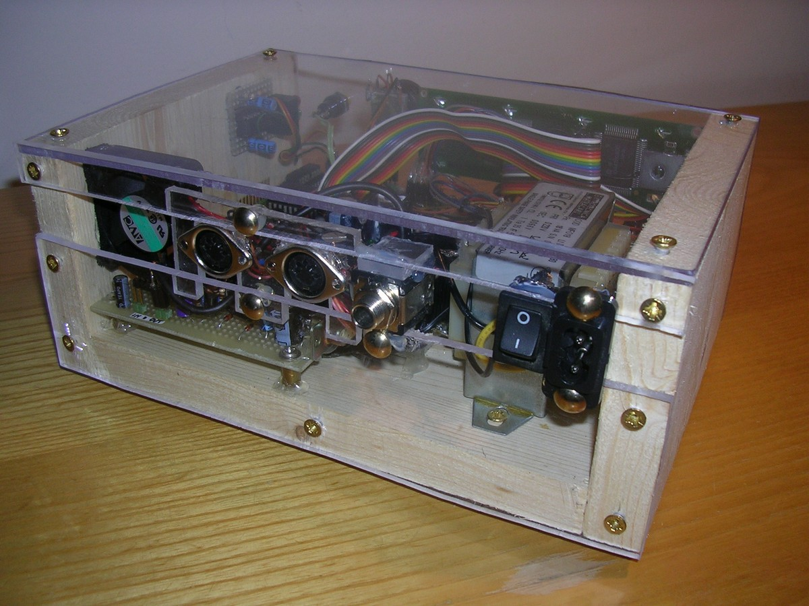
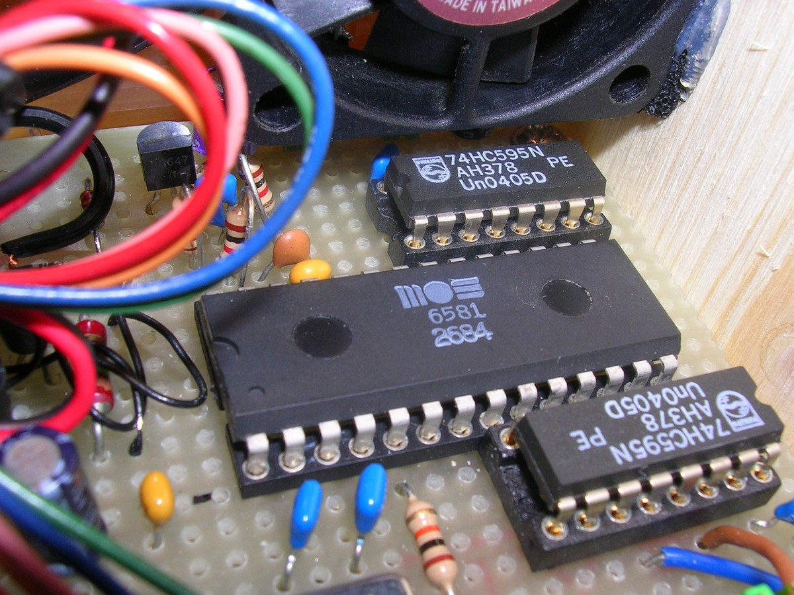

# MIDIBOX SID, IL CHIP DEL COMMODORE 64 IN UN SYNTH MIDI

*Pubblicato: 2025-09-10*

**Tag:** sintetizzatore, do it yourself, DIY, MIDI, programmazione, elettronica, microcontrollori, fai da te, synth, c64, chiptune

---

Il **MOS 6581** è il chip sonoro del Commodore 64: tre oscillatori, un filtro multistato, envelope generabili, e un suono che per un'intera generazione ha significato "videogioco". Nel 1982 era la voce di un home computer; nel 2006 l'ho tolto da lì e l'ho messo al centro di un sintetizzatore MIDI autocostruito sulla piattaforma MIDIbox: il **MIDIbox SID**.

### L'idea

Il progetto, sviluppato da Thorsten Klose sulla piattaforma MIDIbox, risponde a una domanda precisa: cosa succede se il SID non è più limitato dalla CPU del C64? I registri del chip vengono riscritti a **1220 Hz**: sul Commodore 64 la musica aggiornava i registri del SID una volta per frame, 50-60 volte al secondo, perché la 6510 a 1 MHz non poteva fare di più. Il core della MIDIbox, un PIC18F452, lo fa circa venti volte più in fretta.

Questa differenza di velocità è tutta la differenza musicale: sul C64 le modulazioni software erano lente o steppate, qui possono essere fluide e ad alta risoluzione.

### Cosa sa fare

Oltre alle funzioni native del SID (tre oscillatori con forme d'onda miscelabili, sync e ring modulation, filtro low/band/highpass/notch), il firmware aggiunge via software:

- **2 envelope generator** extra, con curve anche non lineari, assegnabili a pitch, pulsewidth e filtro;
- **6 LFO** extra, con le stesse destinazioni di modulazione, combinabili anche per effetti Sample & Hold;
- **wavetable e sequenze di CC** per suoni percussivi, combinabili con l'arpeggiatore per texture complesse ("un SID *deve* avere un arpeggiatore", dice la documentazione);
- modalità **Poly, Mono e Legato**, **key splitting** per suonare le voci separatamente, portamento, **modalità bassline** per i suoni alla 303;
- **BankStick** per le patch (128 per stick) ed editor via SysEx indipendente dal sistema operativo.

### La mia macchina

L'ho costruita nel 2006 su core PIC18F452, nella configurazione essenziale: un solo SID, display, un rotary encoder e sei pulsanti per navigare i menù. Niente foresta di manopole: la macchina si programma dall'encoder, leggendo il display, e le patch vivono su BankStick, 128 per stick.

La macchina è nata con il **6581**, la versione originale, quella dal filtro sporco e saturo che è il suono classico del C64. In seguito ho modificato l'alimentazione (le due generazioni di SID vogliono tensioni diverse) e ho montato un **8580**: più fedele e pulito, e soprattutto il più adatto alla modalità bassline, che sull'8580 suona come deve suonare. È stata una scelta di suono, ma anche di necessità: il 6581, alla fine, mi è servito per riparare un C64 muto.

Venti anni dopo si accende ancora e suona ancora. Non male, per un chip che nel 1982 costava pochi dollari e nel 2026 ha un mercato da collezionisti.

### Per approfondire

Tutta la documentazione del progetto è su [uCApps.de](http://ucapps.de/): la pagina del MIDIbox SID contiene le specifiche complete, i sorgenti e i demo sound.

