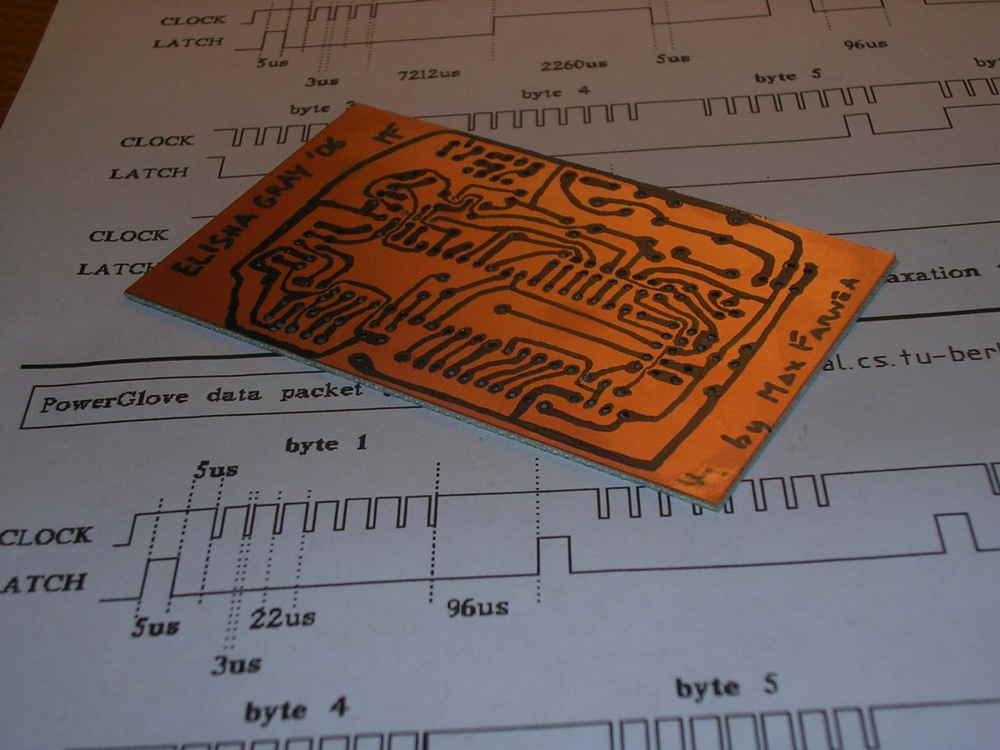
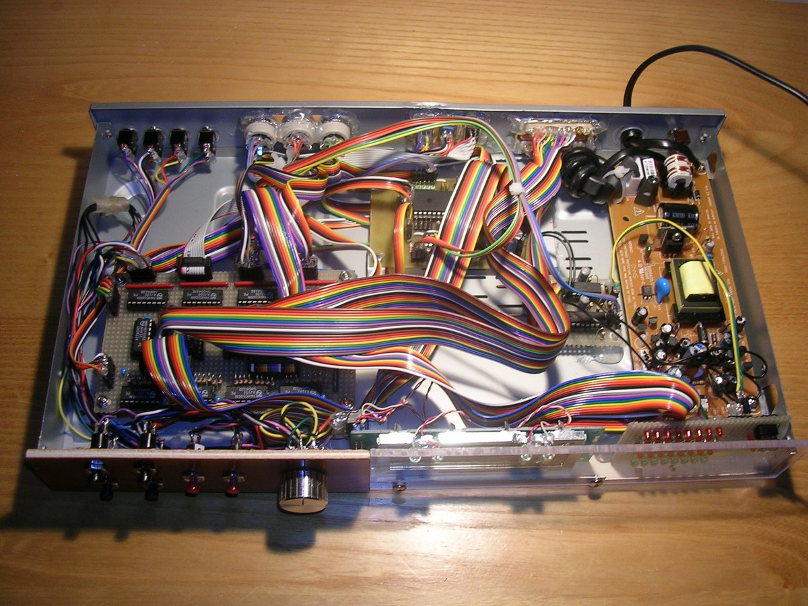
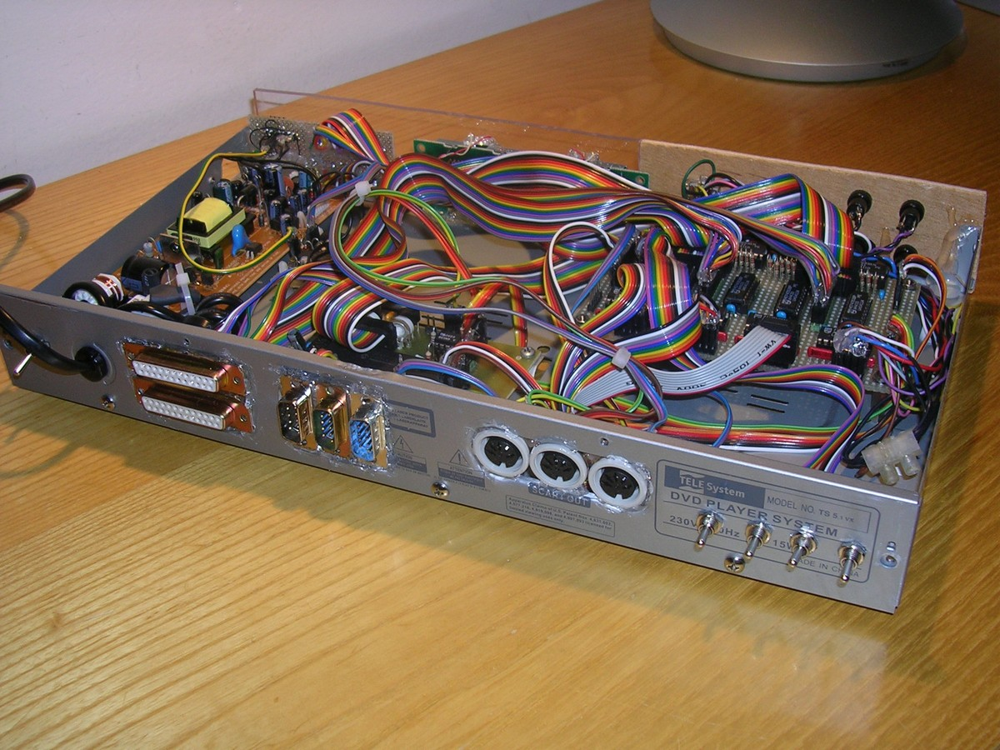
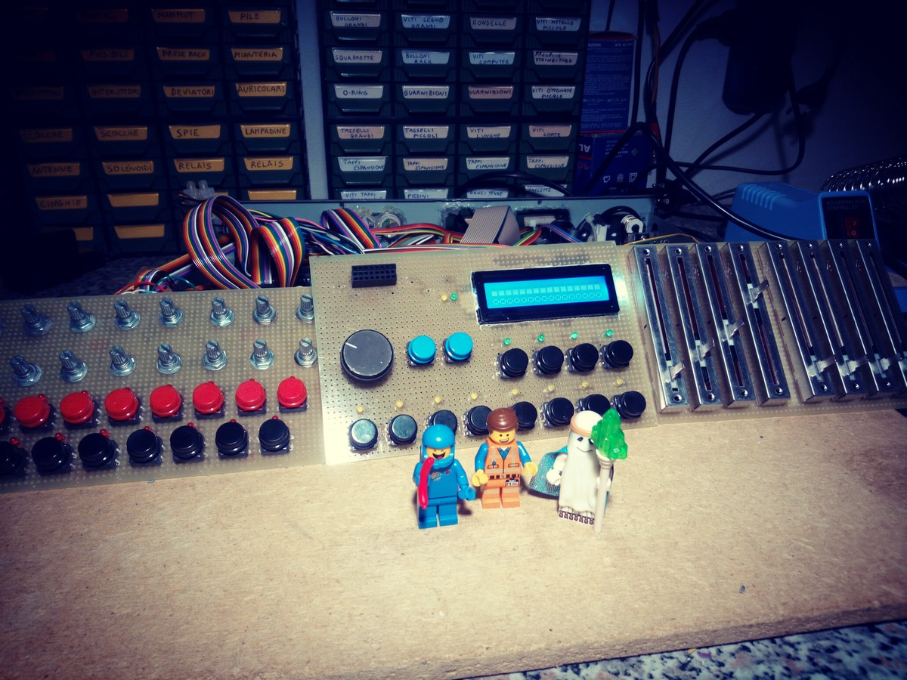
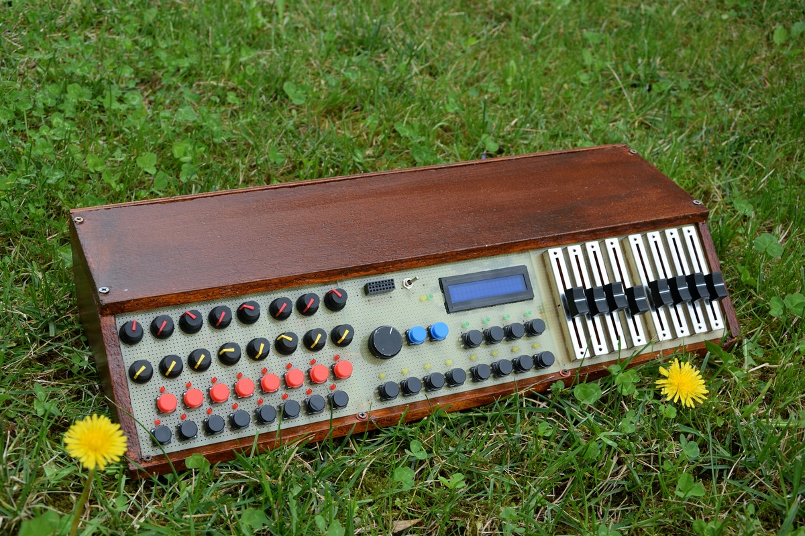

# MIDIBOX64, A CONTROL SURFACE WAITING TO BECOME SOMETHING ELSE

*Published: 2025-10-30*

**Tags:** do it yourself, DIY, MIDI, programming, electronics, microcontrollers, controllers, control surface

---

The **MIDIbox64** is historically the most widespread project of the MIDIbox platform: a configurable MIDI controller, born in 2001, capable of handling up to 64 potentiometers or faders with sub-millisecond latencies, as many buttons and LEDs, banks of configurations saved on BankStick, MIDI Learn, and Meta events up to custom SysEx. A flexible machine: the same architecture can become the mixer of a console, the control panel of a synthesizer or the heart of an installation.

My MIDIbox64, built in 2006 on a PIC18F452 core, is configured like this:

- **32 analog inputs**: 16 connected to potentiometers, 8 to faders, and **8 left free**, accessible from an external connector for future expansions;
- **32 digital inputs**: 24 generic buttons and 8 keys reserved for the navigation and programming interface;
- **32 digital outputs**: as many LEDs giving feedback on button activation.

The firmware, like all the ones on the platform, is loaded via MIDI as a SysEx dump, and every pot, button and LED can be assigned to any MIDI event: notes, CC, Program Change, Aftertouch, Pitch Bender. The configurations live on **BankStick** in interchangeable banks, with names and labels editable directly on the display.

This control surface, actually, was not born as a control surface. In the original configuration the analog and digital buses were brought out to external DB25 ports, to connect **sensors**: light sensors, motion sensors, pressure sensors. The idea was to use it for physical performances with the **Elisha Gray**, my group at the time, where movement on stage would become sound directly. That project never came to be, and the machine waited twenty years in a box.

Recently I rebuilt it in another form: sliders, potentiometers and buttons, a classic control surface for driving the DAW or generating MIDI events for Processing sketches. But I left eight analog inputs free on a connector, exactly as in the original project. The sensors did not arrive in 2006, they did not arrive in 2016: the port is still open. Machines, unlike projects, have no deadlines.

The complete specifications, the firmware and the documentation of the MIDIbox64 are on [uCApps.de](http://ucapps.de/). Worth noting: there is also an alternative firmware that turns it into a 16-track analog sequencer.
