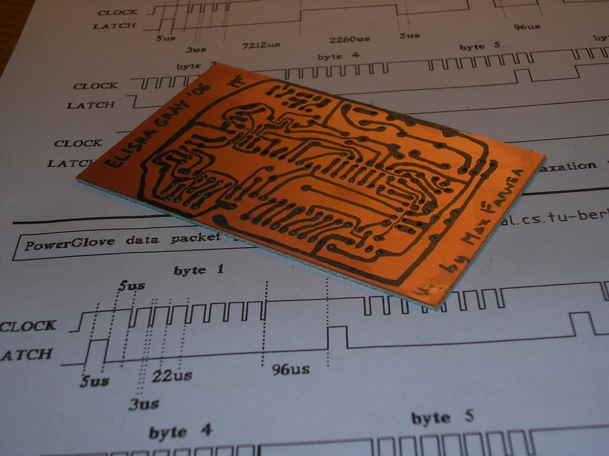
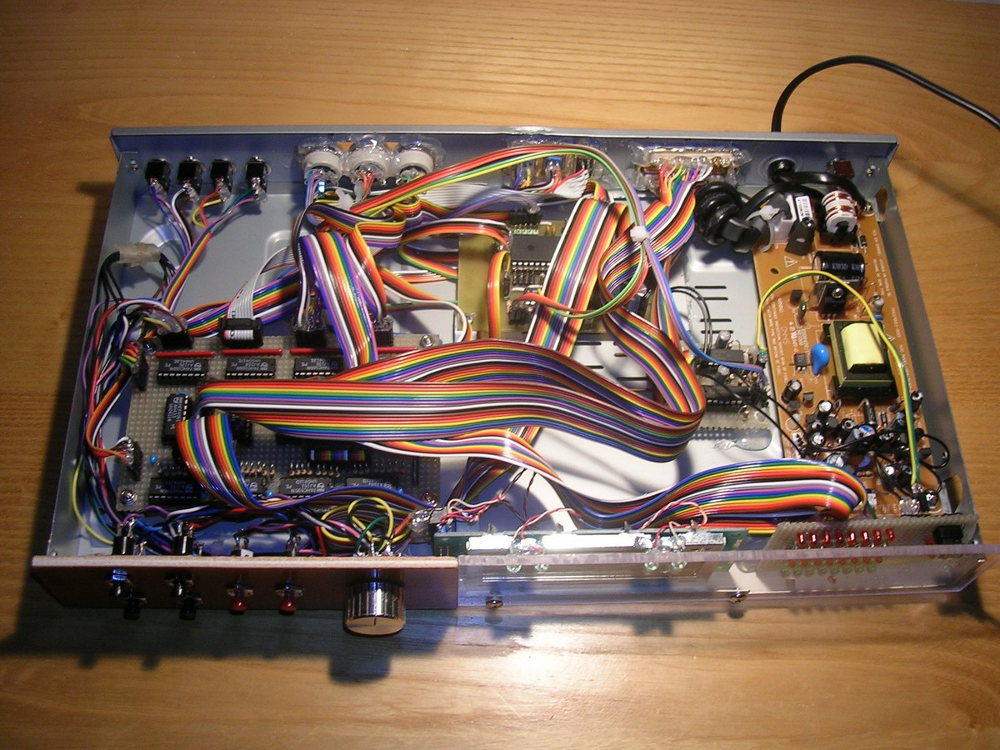
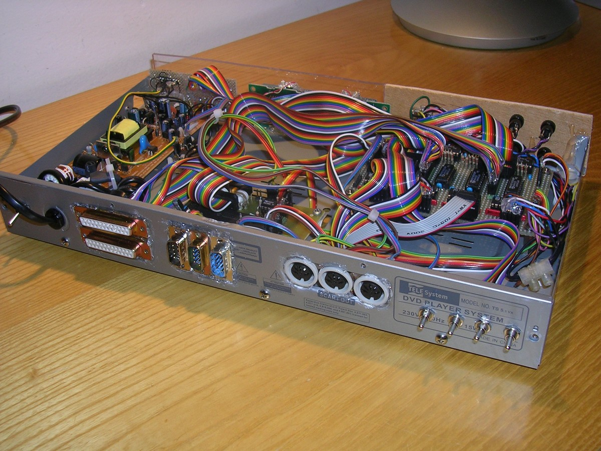
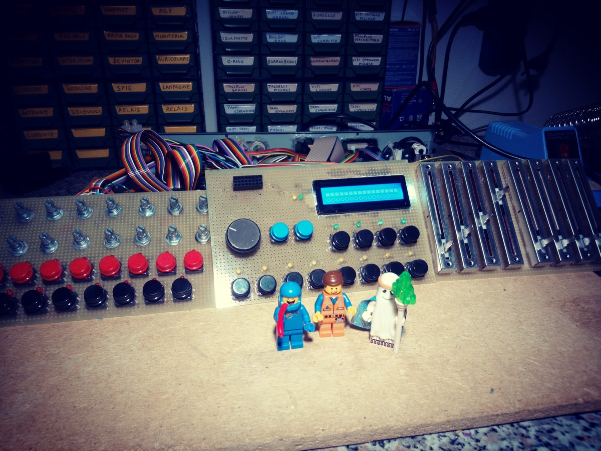
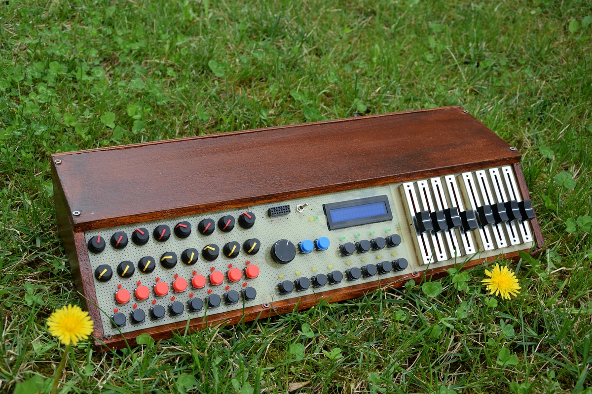

# MIDIBOX64, UNA CONTROL SURFACE CHE ASPETTA DI DIVENTARE ALTRO

*Pubblicato: 2025-10-30*

**Tag:** do it yourself, DIY, MIDI, programmazione, elettronica, microcontrollori, fai da te, controller, control surface

---

La **MIDIbox64** è storicamente il progetto più diffuso della piattaforma MIDIbox: un controller MIDI configurabile, nato nel 2001, in grado di gestire fino a 64 potenziometri o fader con latenze sotto il millisecondo, altrettanti pulsanti e LED, banche di configurazioni salvate su BankStick, MIDI Learn, eventi Meta fino al SysEx custom. Una macchina flessibile: la stessa architettura può diventare il mixer di una consolle, il pannello di controllo di un sintetizzatore o il cuore di un'installazione.

La mia MIDIbox64, costruita nel 2006 su core PIC18F452, è configurata così:

- **32 ingressi analogici**: 16 collegati a potenziometri, 8 a fader, e **8 lasciati liberi**, accessibili da un connettore esterno per future espansioni;
- **32 ingressi digitali**: 24 pulsanti generici e 8 tasti riservati all'interfaccia di navigazione e programmazione;
- **32 uscite digitali**: altrettanti LED che danno feedback sull'attivazione dei pulsanti.

Il firmware, come tutti quelli della piattaforma, si carica via MIDI come dump SysEx, e ogni pot, pulsante e LED può essere assegnato a qualsiasi evento MIDI: note, CC, Program Change, Aftertouch, Pitch Bender. Le configurazioni vivono su **BankStick** in banche intercambiabili, con nomi e label editabili direttamente sul display.

Questa control surface, in realtà, non è nata come control surface. Nella configurazione originale i bus analogici e digitali erano portati su porte DB25 esterne, alle quali collegare **sensori**: sensori luminosi, di movimento, di pressione. L'idea era usarla per performance fisiche con gli **Elisha Gray**, il mio gruppo di allora, dove il movimento sul palco diventasse direttamente suono. Quel progetto non si è mai concretizzato, e la macchina ha aspettato vent'anni in una scatola.

Di recente l'ho ricostruita in un'altra forma: slider, potenziometri e pulsanti, una control surface classica per controllare la DAW o generare eventi MIDI per sketch Processing. Ma ho lasciato otto ingressi analogici liberi su connettore, esattamente come nel progetto originale. I sensori non sono arrivati nel 2006, non sono arrivati nel 2016: la porta è ancora aperta. Le macchine, a differenza dei progetti, non hanno scadenze.

Le specifiche complete, il firmware e la documentazione della MIDIbox64 sono su [uCApps.de](http://ucapps.de/). Da segnalare: esiste anche un firmware alternativo che la trasforma in un sequencer analogico a 16 tracce.