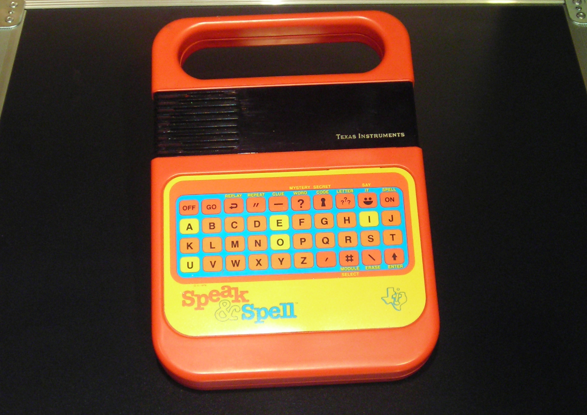
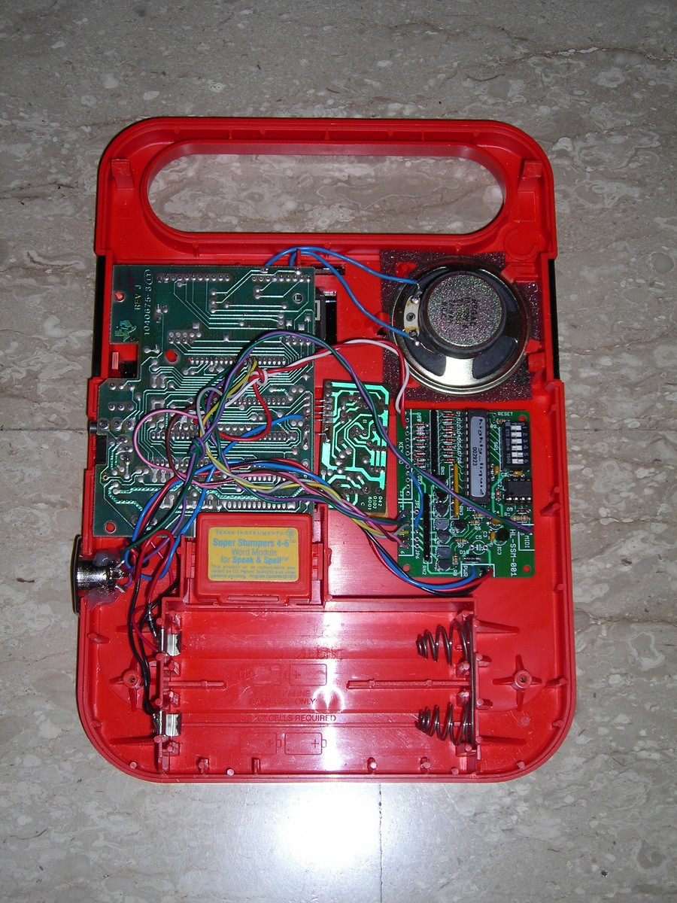

Il **Grillo Parlante** è la versione italiana dello **Speak & Spell** di Texas Instruments: il giocattolo parlante degli anni Ottanta, quello che insegna a scrivere le parole e le pronuncia con quella voce robotica impagabile. Il mio è in realtà uno Speak & Spell americano, ma io lo chiamo comunque Grillo Parlante: per me conta il nome della voce, non quello dell'etichetta. Dentro non c'è un campionatore: c'è un sintetizzatore di fonemi, la voce è costruita al volo incollando suoni elementari, i **fonemi**, l'uno dietro l'altro. E' una macchina che parla per mattoncini.

Vent'anni fa comprai un kit per aggiungerci una porta MIDI: il **MIDISpeak**, di Highly Liquid, una piccola realtà che produceva retrofit MIDI per giocattoli e circuiti vintage. Il kit (una PCB, tutti i componenti, la presa MIDI) si salda e si collega alle linee del giocattolo, senza sostituire nulla: la logica del giocattolo resta integra, il kit si limita a interagire col circuito al posto tuo, via MIDI.

Highly Liquid, purtroppo, non esiste più: il sito è scomparso e con lui la documentazione. Di quel progetto resta traccia nell'archivio della Wayback Machine ([qui la pagina del kit](https://web.archive.org/web/20080126130755/http://highlyliquid.com/kits/midispeak/)).

Il MIDISpeak offre due modalità di funzionamento. In **ROM Mode** le note MIDI triggerano i suoni memorizzati nel giocattolo, in 128 bank selezionabili: parole intere, frasi, effetti. In **Keypad Mode** le note 50-89 replicano la tastiera del giocattolo (le lettere, e le parole composte lettera per lettera) mentre le note 90-92 sono trigger "glitch" dedicati. E' quest'ultima la porta d'ingresso verso il lato musicale: il sintetizzatore del Grillo parla per **fonemi**, e via MIDI i fonemi possono essere richiamati **singolarmente**, in qualsiasi ordine, a qualsiasi velocità. Parole che non esistono, frasi spezzate, sillabe in loop: la voce del giocattolo si sgretola in materia sonora.

Ma perché comprare un kit per modificare un giocattolo quando per la scena del circuit bending questo è uno degli esempi più famosi di macchina da sabotare? Perché il circuit bending brutale è una strada, e la conservazione è un'altra. Il Grillo Parlante, per me, non era un oggetto di scarto: era un oggetto d'infanzia, e volevo che restasse riconoscibile, con porta MIDI in più, ma integro. Il kit rispetta la macchina: si aggiunge, non sottrae. 

All'interno del Grillo Parlante c'è abbastanza posto per la scheda del retrofit MIDI, e basta saldare pochi fili per l'alimentazione e per accedere alle linee di controllo. L'unico intervento invasivo è il foro per la presa DIN MIDI a 5 poli.

