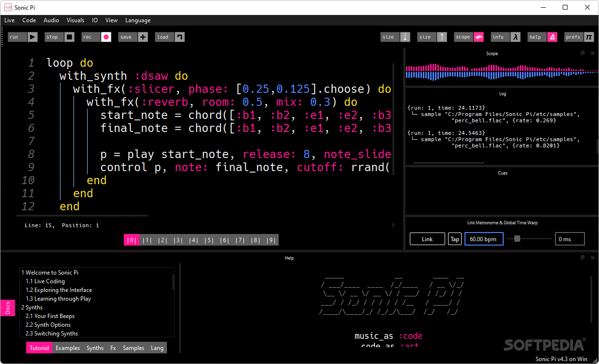

# LIVE CODING, O QUANDO IL PROGRAMMA DIVENTA STRUMENTO

*Pubblicato: 2026-11-19*

**Tag:** live coding, sperimentale, algoritmi, programmazione, elettronica, MIDI, synth, sonic pi, algorave

---

Esistono musicisti che suonano il codice. Letteralmente: non una partitura, non un sequencer programmato, ma le istruzioni scritte in diretta, a schermo aperto, davanti al pubblico. Il movimento si chiama **live coding**, e nel suo ramo musicale più frequentato, **algorave**, la gente balla davanti a un proiettore pieno di righe di codice.

Il testo fondativo è il manifesto di **TOPLAP**, la comunità nata in un bar fumoso di Amburgo nel 2004. È scritto come un decalogo di rivendicazioni, e merita di essere citato:

> *Give us access to the performer's mind, to the whole human instrument. Obscurantism is dangerous. Show us your screens.*
>
> *Programs are instruments that can change themselves.*
>
> *Code should be seen as well as heard, underlying algorithms viewed as well as their visual outcome.*
>
> *Live coding is not about tools. Algorithms are thoughts. Chainsaws are tools.*

Le rivendicazioni proseguono: improvvisazione estemporanea dell'algoritmo come gesto espressivo, e **no backup**, niente tracce preregistrate, niente computer di riserva. E infine un'ammissione onesta: il pubblico non deve capire il codice per apprezzarlo, come non serve saper suonare la chitarra per assistere a un concerto. Lo schermo non è un backstage esposto per sfida: è parte dello spettacolo, il luogo dove il pensiero diventa suono in tempo reale.

Da quel manifesto è nato **algorave**: rave dove al posto del DJ c'è qualcuno che scrive il beat mentre gira, e il momento più bello è quando il codice e la musica crescono insieme.

Chi legge questo blog da tempo sa che cerco sempre l'algoritmo dentro i processi creativi, non come esecutore, ma come elemento del suono. L'ho scritto a proposito di Macchina Harmoniosa, il sequencer generativo basato su Arduino: il punto di partenza è lo stesso. Un algoritmo **deterministico**, di sua natura, quando lo combini con rumore (stocastico controllato, Perlin noise e affini) smette di essere una sequenza ripetuta e diventa un **pattern vivo**, che evolve e sorprende anche chi l'ha scritto. È esattamente il tipo di musica che mi interessa: instabile, imprevedibile ma non casuale.

Il live coding porta questa idea all'estremo: non più un algoritmo scritto una volta e chiuso dentro una macchina, ma **riscritto , mentre suona dal vivo**. Il rischio è concreto, una svista e il pattern muore sul palco. Però l'errore, in questo mondo, non è un fallimento: come dice anche Sam Aaron, è un'**opportunità**, una porta che si apre. L'errore che trasforma un loop in qualcosa che non avevi previsto, la nota fuori scala che diventa il nuovo centro del pattern. Chi suona circuiti manomessi con il circuit bent lo sa: il guasto è solo uno scenario che non avevi ancora esplorato.

Il mio strumento di riferimento è **Sonic Pi**, di Sam Aaron: un ambiente di live coding basato su Ruby, nato per insegnare la programmazione nelle scuole e cresciuto fino a diventare uno strumento musicale completo (synth interni, campionamento, un clock di precisione per la sincronizzazione, MIDI e OSC verso il mondo esterno). Il progetto è open source, curato con continuità dal 2013 fino a oggi; lo supporto su **Patreon dal 2018**, perché ci credo su due piani: come strumento creativo e come strumento educativo (in ottica **S.T.E.A.M.**).

Esistono anche alternative molto valide e più recenti, come **Strudel** (la reimplementazione in JavaScript di TidalCycles), che gira direttamente nel browser ed è fortissima per la generazione di pattern ritmici. Ma finora mi sento ancora a mio agio con Sonic Pi: workflow consolidatoe la possibilità di portare sul palco synth MIDI o generare eventi OSC con cui interfacciarmi con Processing e generare programmaticamente anche visuals in sync con la musica.

Il manifesto completo è sul [sito di TOPLAP](https://toplap.org/), la documentazione di Sonic Pi su [sonic-pi.net](https://sonic-pi.net/).
